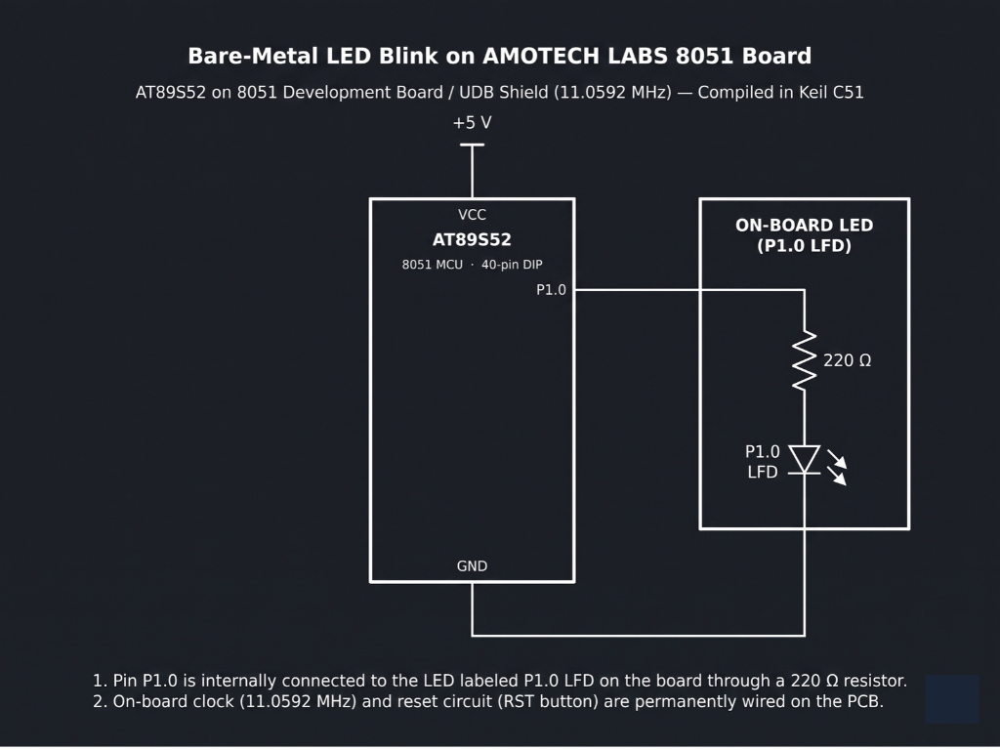

# Continuous Lab Evaluation-2

**EXP:** Continuous Lab Evaluation-2  
**DATE:** 23/07/2026  
**NAME OF EXP:** LED BLINKING — Bare-Metal LED Blink on AMOTECH LABS 8051 Board  
**HARDWARE SETUP / PLATFORM:** Keil C51 + AMOTECH LABS 8051 Development Board / UDB Shield (AT89S52, 11.0592 MHz) + On-board LED (`P1.0 LFD`)  
**TASK NO:** 2  

---

### Circuit Diagram


---

### Core Logic

* **1. SFR Inclusion & Bit-Level GPIO Mapping**
  Includes `<reg51.h>` to expose the AT89S52 Special Function Registers[cite: 38] and maps `P1.0`—which routes internally to the on-board `P1.0 LFD` indicator via a `220 Ω` current-limiting resistor—to the single-bit identifier `LED` using the `sbit` qualifier[cite: 38, 39].
  ```c
  #include <reg51.h>

  sbit LED = P1^0;
  ```

* **2. Nested Software Delay Loop**
  Implements a blocking time delay calibrated against the `11.0592 MHz` on-board crystal[cite: 39] using nested `for` loops to burn CPU instruction cycles between output transitions without relying on hardware timers or external libraries[cite: 38].
  ```c
  void delay(void) {
      unsigned int i, j;
      for (i = 0; i < 500; i++) {
          for (j = 0; j < 500; j++) {
          }
      }
  }
  ```

* **3. Port Initialization & Active-High Toggle Loop**
  Clears all Port 1 pins (`P1 = 0x00`) to a known LOW state on startup, then continuously drives `LED` (`P1.0`) high (`1`) and low (`0`) separated by `delay()` calls inside an infinite `while(1)` super-loop to toggle `P1.0 LFD` through its `220 Ω` series resistor to ground[cite: 38, 39].
  ```c
  void main(void) {
      P1 = 0x00; // Initialize Port 1 pins to LOW state

      while (1) {
          LED = 1;      // Turn LED ON 
          delay();
          LED = 0;      // Turn LED OFF 
          delay();
      }
  }
  ```

---

### Inference
Initializing Port 1 to `0x00` and directly manipulating bit `P1.0` via `sbit` in Keil C51 successfully controlled the on-board `P1.0 LFD` indicator connected through its `220 Ω` series resistor to ground[cite: 38, 39]. Running the toggle sequence with nested software delay loops on the `11.0592 MHz` AT89S52 board produced reliable, bare-metal periodic LED blinking without using any HAL or RTOS abstractions[cite: 38, 39].