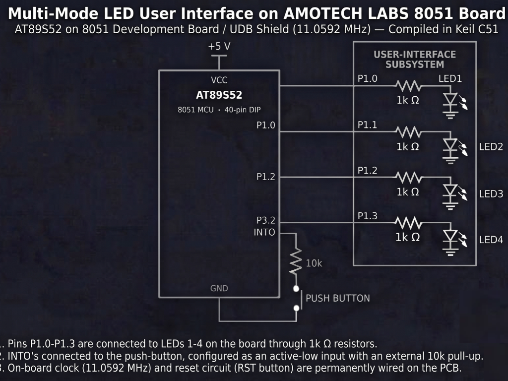

# Continuous Lab Evaluation-3

**EXP:** Continuous Lab Evaluation-3  
**DATE:** 27/07/2026  
**NAME OF EXP:** Timer-Based LED Pattern Generator and Button Interrupt Controller — Multi-Mode LED User Interface on AMOTECH LABS 8051 Board[cite: 41, 42]  
**HARDWARE SETUP / PLATFORM:** Keil C51 + AMOTECH LABS 8051 Development Board / UDB Shield (AT89S52, 11.0592 MHz) + 4 On-board LEDs (`P1.0–P1.3`) + Push Button (`P3.2 / INT0`)[cite: 41, 42]  
**TASK NO:** 3[cite: 14]  

---

### Circuit Diagram


---

### Core Logic

* **1. SFR Inclusion & Bit-Level Peripheral Mapping**
  Includes `<reg52.h>` for AT89S52 Special Function Register definitions and maps the four user-interface LEDs (`LED1–LED4`) to `P1.0–P1.3` (wired through `1k Ω` series resistors) and the active-low push button to `P3.2` (`INT0`, pulled up externally with a `10k Ω` resistor) using `sbit`[cite: 41].
  ```c
  #include <reg52.h>

  // LED connections
  sbit LED1 = P1^0;
  sbit LED2 = P1^1;
  sbit LED3 = P1^2;
  sbit LED4 = P1^3;

  // Push button connected to INT0
  sbit BUTTON = P3^2;
  ```

* **2. 1 ms Timer 0 Time Base & Atomic Tick Reader**
  Configures Timer 0 in 16-bit Mode 1 (`TMOD = 0x01`) with reload value `0xFC66` calibrated for the `11.0592 MHz` crystal to trigger an interrupt every `1 ms`, incrementing `ms_ticks`[cite: 17, 41]. `get_ms()` briefly disables `ET0` to read the 16-bit counter atomically without tearing.
  ```c
  void Timer0_ISR(void) interrupt 1
  {
      TH0 = 0xFC;
      TL0 = 0x66;
      ms_ticks++;
  }

  unsigned int get_ms(void)
  {
      unsigned int t;
      ET0 = 0;
      t = ms_ticks;
      ET0 = 1;
      return t;
  }
  ```

* **3. Falling-Edge `INT0` Interrupt & Non-Blocking Software Debounce**
  Configures `INT0` (`P3.2`) as falling-edge triggered (`IT0 = 1`)[cite: 41]. On a press, `INT0_ISR` disables `EX0` and flags `buttonEvent` so the main loop can validate both press and release states over a `30 ms` (`DEBOUNCE_TIME`) non-blocking window before advancing `mode` (`1` to `4`), ensuring one physical press produces exactly one state transition[cite: 42].
  ```c
  void INT0_ISR(void) interrupt 0
  {
      EX0 = 0;          // Disable INT0 temporarily
      buttonEvent = 1;  // Inform main program
  }

  if(pendingPress == 1)
  {
      if((unsigned int)(now - pressCheckTime) >= DEBOUNCE_TIME)
      {
          pendingPress = 0;
          if(BUTTON == 0)
          {
              mode++;
              if(mode > 4) mode = 1;
              step = 0;
              lastPattern = now;
          }
      }
  }
  ```

* **4. Masked Port Output & Four-State Pattern Engine**
  Updates only the lower nibble of Port 1 (`P1 = (P1 & 0xF0) | (value & 0x0F)`) every `250 ms` (`PATTERN_DELAY`) without blocking CPU execution[cite: 41], cycling through **Mode 1** (Running LED `1 << step`), **Mode 2** (4-bit Binary Counter `0x00–0x0F`), **Mode 3** (Alternating `0x0A` / `0x05`), and **Mode 4** (All-LED Flash `0x0F` / `0x00`)[cite: 42].
  ```c
  void LED_Display(unsigned char value)
  {
      P1 = (P1 & 0xF0) | (value & 0x0F);
  }

  if((unsigned int)(now - lastPattern) >= PATTERN_DELAY)
  {
      lastPattern = now;
      if(mode == 1)      { step = (step + 1) % 4;  LED_Display(1 << step); }
      else if(mode == 2) { step = (step + 1) % 16; LED_Display(step); }
      else if(mode == 3) { step = !step; LED_Display(step == 0 ? 0x0A : 0x05); }
      else if(mode == 4) { step = !step; LED_Display(step == 0 ? 0x0F : 0x00); }
  }
  ```

---

### Inference
Combining Timer 0's `1 ms` interrupt-driven time base (`0xFC66` reload at `11.0592 MHz`) with falling-edge external interrupt `INT0` (`P3.2`) enabled responsive, non-blocking control over the four `P1.0–P1.3` LEDs[cite: 17, 41]. The `30 ms` press-and-release state machine cleanly eliminated mechanical switch bounce so each button press reliably stepped through the running, binary counter, alternating, and flashing LED modes without blocking pattern execution[cite: 42].