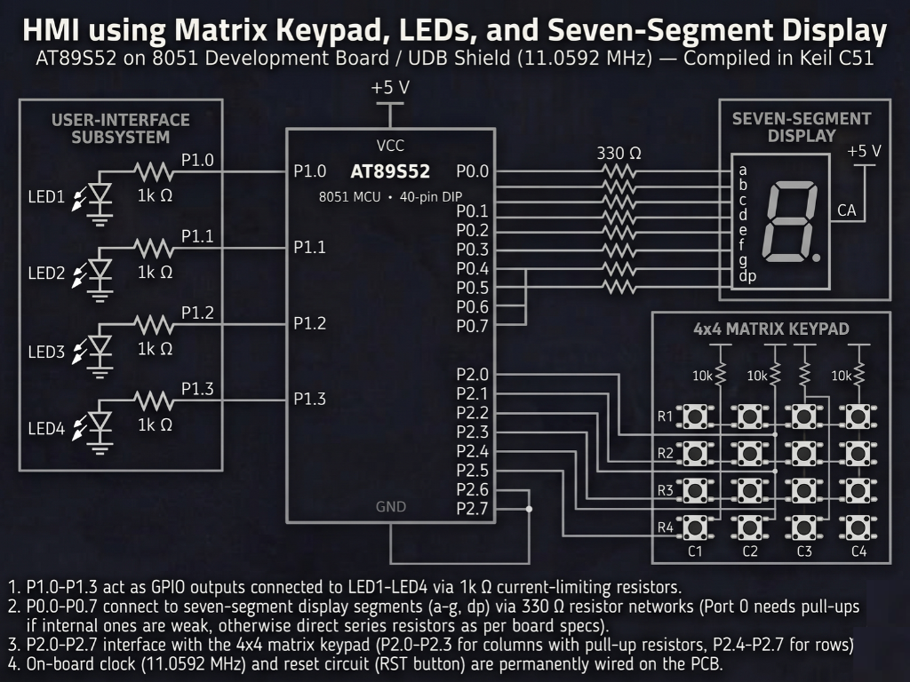

# Continuous Lab Evaluation-4

**EXP:** Continuous Lab Evaluation-4  
**DATE:** 03/08/2026  
**NAME OF EXP:** Human-Machine Interface using Matrix Keypad, LEDs, and Seven-Segment Display — HMI using Matrix Keypad, LEDs, and Seven-Segment Display
**HARDWARE SETUP / PLATFORM:** Keil C51 + AMOTECH LABS 8051 Development Board / UDB Shield (AT89S52, 11.0592 MHz) + 4x4 Matrix Keypad (`P2.0–P2.7`) + Seven-Segment Display (`P0.0–P0.7`) + 4 On-board LEDs (`P1.1–P1.4`) 
**TASK NO:** 4  

---

### Circuit Diagram


---

### Core Logic

* **1. SFR Inclusion & Multi-Peripheral Pin Mapping**
  Includes `<reg52.h>` for AT89S52 Special Function Register definitions and maps the `4x4` matrix keypad column lines (`COL1–COL4`) to `P2.7–P2.4` (with rows driven on `P2.3–P2.0` via `10k Ω` pull-ups), while assigning the four indicator LEDs (`LED1–LED4`) to `P1.1–P1.4` and the seven-segment display segments (`a–g, dp`) across `P0.0–P0.7` through `330 Ω` current-limiting resistors.
  ```c
  #include <reg52.h> 
   
  sbit COL1 = P2^7; 
  sbit COL2 = P2^6; 
  sbit COL3 = P2^5;
  sbit COL4 = P2^4;

  sbit LED1 = P1^1;
  sbit LED2 = P1^2;
  sbit LED3 = P1^3;
  sbit LED4 = P1^4;
  ```

* **2. Row-Scanning Matrix Keypad Decoder & Debounce (`keypad_scan`)**
  Sequentially pulls individual row lines low on the lower nibble of Port 2 (`0xF7`, `0xFB`, `0xFD`), samples the upper-nibble column pins (`COL1–COL4`), confirms valid key presses after a software debounce `delay()`, updates `mode` and `value`, and waits for key release before returning.
  ```c
  void keypad_scan() {
      P2 = 0xF7; // Scan Row 1 (P2.3)
      if(COL1 == 0) {
          delay();
          if(COL1 == 0) {
              mode = 1;
              value = 1;
              while(COL1 == 0);
          }
      }
      // ... scans remaining rows (0xFB, 0xFD) and columns (COL1-COL4)
      display_digit(value);
  }
  ```

* **3. Seven-Segment Lookup Decoder (`display_digit`)**
  Maps the decoded numeric key (`0–9`) to its corresponding hexadecimal segment bitmask (`0x3F` through `0x6F`) and writes it directly to `P0` to illuminate the pressed digit on the seven-segment display.
  ```c
  void display_digit(unsigned char value) {
      if(value == 0)      { P0 = 0x3F; }
      else if(value == 1) { P0 = 0x06; }
      else if(value == 2) { P0 = 0x5B; }
      // ... maps digits 3 through 8
      else if(value == 9) { P0 = 0x6F; }
  }
  ```

* **4. Modular LED Mode Execution (`led_control`, `running_led`, `binary_counter`, `alternate_led`, `blink_all`)**
  Dispatches the active `mode` inside the main `while(1)` loop to drive individual LEDs (`1 << key` for keys `1–4`), sequential running shifts (`0x02 → 0x04 → 0x08 → 0x10` for key `5`), alternating patterns (`0x0A` / `0x14` for key `6`), a `0–15` binary counter (key `7`), all-LED flashing (`0x1E` / `0x00` for key `8`), or system reset/LEDs off (keys `0` and `9`).
  ```c
  switch(mode)
  {
      case 1: case 2: case 3: case 4:
          led_control(mode);
          break;
      case 5:
          running_led();
          break;
      case 6:
          while(mode == 6) {
              alternate_led();
              keypad_scan();
          }
          break;
      case 7:
          binary_counter();
          break;
      case 8:
          blink_all();
          break;
  }
  ```

---

### Inference
Interfacing the `4x4` matrix keypad on Port 2, seven-segment display on Port 0, and indicator LEDs on Port 1 of the `11.0592 MHz` AT89S52 development board created a complete bare-metal human-machine interface without external libraries. Row-column scanning with software debouncing reliably captured user key presses (`0–9`), synchronized real-time numeric feedback on the seven-segment display, and switched cleanly across all individual and animated LED operating modes.