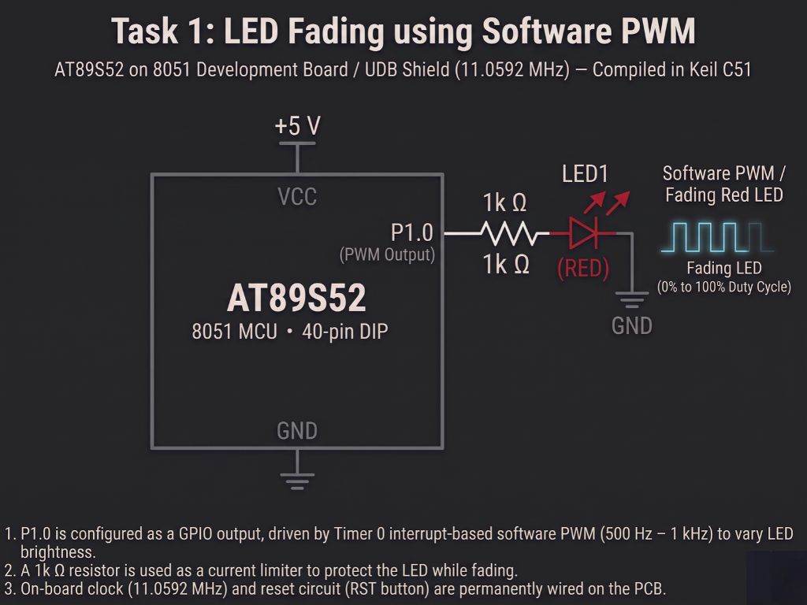

# Continuous Lab Evaluation-5A

**EXP:** Continuous Lab Evaluation-5A  
**DATE:** 10/08/2026  
**NAME OF EXP:** Hardware Timer and Interrupt-Based Timing for LED Fading, Pulse Generation, and Stepper Motor Control — Timer 0 Interrupt-Driven 1-Second LED Toggle
**HARDWARE SETUP / PLATFORM:** Keil C51 + AMOTECH LABS 8051 Development Board / UDB Shield (AT89S52, 11.0592 MHz) + On-board Red LED (`LED1` on `P1.0` via `1k Ω` resistor)
**TASK NO:** 5A  

---

### Circuit Diagram


---

### Core Logic

* **1. SFR Inclusion & Single-Bit LED Pin Mapping**
  Includes `<reg51.h>` for Special Function Register definitions and maps `P1.0`—which connects to the on-board red `LED1` through a `1k Ω` current-limiting resistor to ground—using the `sbit` qualifier.
  ```c
  #include <reg51.h>

  sbit LED = P1^0;

  unsigned int count = 0;
  ```

* **2. Timer 0 Mode 1 Configuration & Interrupt Initialization**
  Configures Timer 0 in 16-bit timer mode (`TMOD = 0x01`), preloads `TH0 = 0xFC` and `TL0 = 0x66` (`65536 - 922 = 64614`) for a `1 ms` overflow interval at `11.0592 MHz` ($T_{\text{machine}} \approx 1.085\ \mu\text{s}$), enables Timer 0 and global interrupts (`ET0 = 1`, `EA = 1`), and starts the timer (`TR0 = 1`).
  ```c
  TMOD = 0x01; // Configure Timer 0 in Mode 1 (16-bit)

  TH0 = 0xFC;  // Load initial timer values for 1 ms
  TL0 = 0x66;

  ET0 = 1;     // Enable Timer 0 interrupt
  EA = 1;      // Enable global interrupt
  TR0 = 1;     // Start Timer 0
  ```

* **3. Non-Blocking 1 ms ISR & 1-Second Software Time Base**
  Re-arms `TH0` and `TL0` (`0xFC66`) inside `Timer0_ISR` (`interrupt 1`) on every `1 ms` overflow, increments `count`, and complements `LED` (`LED = ~LED`) once `count` reaches `1000` (`1 second`) while the main `while(1)` loop remains completely idle and free of blocking software delays.
  ```c
  void Timer0_ISR(void) interrupt 1
  {
      // Reload Timer 0 for 1 ms
      TH0 = 0xFC;
      TL0 = 0x66;

      count++;

      // 1000 interrupts = 1 second
      if(count >= 1000)
      {
          LED = ~LED;
          count = 0;
      }
  }
  ```

---

### Inference
Configuring Timer 0 in 16-bit Mode 1 with a `0xFC66` reload value on the `11.0592 MHz` AT89S52 board generated a precise `1 ms` hardware interrupt tick without using blocking delay loops. Accumulating `1000` timer overflows inside the ISR established an accurate `1-second` software time base that toggled `LED1` on `P1.0` reliably while keeping the main super-loop non-blocking.