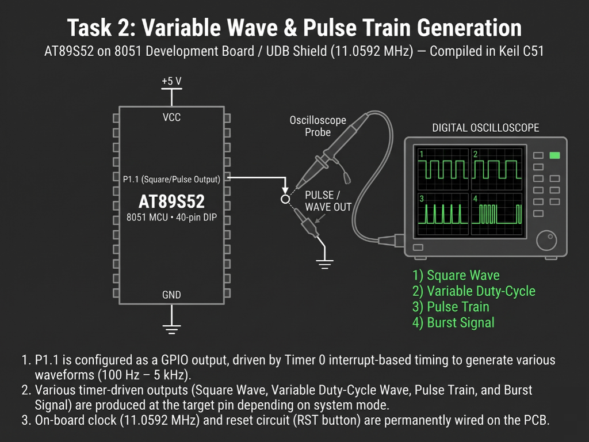

# Continuous Lab Evaluation-5B.1

**EXP:** Continuous Lab Evaluation-5B.1  
**DATE:** 01/09/2026  
**NAME OF EXP:** Hardware Timer and Interrupt-Based Timing — LED Fading using Software PWM 
**HARDWARE SETUP / PLATFORM:** Keil C51 + AMOTECH LABS 8051 Development Board / UDB Shield (AT89S52, 11.0592 MHz) + On-board Red LED (`LED1` on `P1.0` via `1k Ω` resistor)
**TASK NO:** 5B.1  

---

### Circuit Diagram


---

### Core Logic

* **1. SFR Inclusion, LED Mapping & PWM State Variables**
  Includes `<reg52.h>` for AT89S52 Special Function Register definitions, maps `P1.0`—which drives the on-board red `LED1` through a `1k Ω` current-limiting resistor—to `LED`, and initializes global state counters for the PWM slice (`pwm_count`), active duty cycle (`duty`), fade step prescaler (`fade_count`), and ramp `direction`.
  ```c
  #include <reg52.h>

  sbit LED = P1^0;

  unsigned char pwm_count = 0;
  unsigned char duty = 0;
  unsigned char fade_count = 0;
  unsigned char direction = 1;
  ```

* **2. High-Frequency Timer 0 Interrupt Setup**
  Configures Timer 0 in 16-bit Mode 1 (`TMOD = 0x01`) with reload values `TH0 = 0xFF` and `TL0 = 0xF7` (`65536 - 9 = 65527`, generating a `~10 µs` interrupt tick at `11.0592 MHz` for a `~1 kHz` 100-step PWM carrier), enables `ET0` and `EA`, and starts `TR0` while keeping `while(1)` completely non-blocking.
  ```c
  void main(void)
  {
      LED = 0;

      TMOD = 0x01;

      TH0 = 0xFF;
      TL0 = 0xF7;

      ET0 = 1;
      EA = 1;
      TR0 = 1;

      while(1)
      {
      }
  }
  ```

* **3. Software PWM Duty-Cycle Comparison & Bidirectional Fade Ramp**
  Inside `timer0_ISR` (`interrupt 1`), compares `pwm_count` (`0–99`) against `duty` to modulate the `P1.0` pulse width on every tick. Every `10` complete PWM cycles (`fade_count >= 10`), `duty` increments from `0%` to `100%` and decrements back to `0%` via `direction`, producing a smooth breathing LED fade effect.
  ```c
  void timer0_ISR(void) interrupt 1
  {
      TH0 = 0xFF;
      TL0 = 0xF7;

      LED = (pwm_count < duty) ? 1 : 0;
      pwm_count++;

      if(pwm_count >= 100)
      {
          pwm_count = 0;
          fade_count++;

          if(fade_count >= 10)
          {
              fade_count = 0;
              if(direction == 1)
                  (duty < 100) ? duty++ : (direction = 0);
              else
                  (duty > 0) ? duty-- : (direction = 1);
          }
      }
  }
  ```

---

### Inference
Driving Timer 0 in 16-bit Mode 1 with a `0xFFF7` reload value on the `11.0592 MHz` AT89S52 board generated a fast periodic interrupt slice capable of synthesizing a flicker-free `~1 kHz` software PWM signal on `P1.0`. Automatically sweeping the duty cycle between `0%` and `100%` every `10` PWM frames smoothly varied the average current through the `1k Ω` resistor and red `LED1`, achieving continuous non-blocking LED fading without software delay loops.