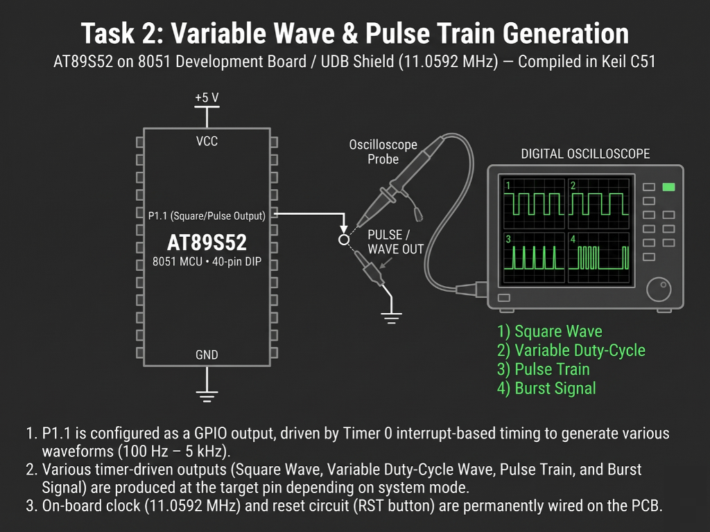

# Continuous Lab Evaluation-5B.3

**EXP:** Continuous Lab Evaluation-5B.3  
**DATE:** 01/09/2026  
**NAME OF EXP:** Hardware Timer and Interrupt-Based Timing — Variable Duty-Cycle Wave Generation. 
**HARDWARE SETUP / PLATFORM:** Keil C51 + AMOTECH LABS 8051 Development Board / UDB Shield (AT89S52, 11.0592 MHz) + Oscilloscope Probe / On-board LED (`P1.0` / `P1.1`)  
**TASK NO:** 5B.3  

---

### Circuit Diagram


---

### Core Logic

* **1. SFR Inclusion, Output Pin Mapping & Duty-Cycle State Variables**
  Includes `<reg52.h>` for AT89S52 Special Function Register definitions, maps the output pin via `sbit`, and declares global counters for the 100-slice PWM period (`pwm_count`), active pulse width (`duty`), ramp step prescaler (`fade_count`), and sweep `direction`.
  ```c
  #include <reg52.h>

  sbit LED = P1^0;

  unsigned char pwm_count = 0;
  unsigned char duty = 0;

  unsigned char fade_count = 0;
  unsigned char direction = 1;
  ```

* **2. Timer 1 Mode 1 High-Speed Time-Slice Configuration**
  Configures Timer 1 in 16-bit Mode 1 (`TMOD = 0x10`) with preload values `TH1 = 0xFF` and `TL1 = 0xF7` (`65536 - 9 = 65527`, yielding a `~10 µs` interrupt tick at `11.0592 MHz` and a `~1 kHz` 100-step waveform period), enables `ET1` and `EA`, and starts `TR1` while keeping `while(1)` completely non-blocking.
  ```c
  void main(void)
  {
      LED = 0;

      TMOD = 0x10;

      TH1 = 0xFF;
      TL1 = 0xF7;

      ET1 = 1;
      EA = 1;
      TR1 = 1;

      while(1)
      {
      }
  }
  ```

* **3. Asymmetric High/Low Time Modulation & Triangular Duty Ramp (`timer1_ISR`)**
  Inside `timer1_ISR` (`interrupt 3`), compares `pwm_count` (`0–99`) against `duty` on every tick to set the active HIGH duration (`pwm_count < duty`) and complementary LOW duration (`pwm_count >= duty`), sweeping `duty` between `0%` and `100%` every `10` complete waveform frames (`fade_count >= 10`) to vary pulse width continuously while holding carrier frequency constant.
  ```c
  void timer1_ISR(void) interrupt 3
  {
      TH1 = 0xFF;
      TL1 = 0xF7;

      LED = (pwm_count < duty) ? 1 : 0;
      pwm_count++;

      if(pwm_count >= 100)
      {
          pwm_count = 0;
          fade_count++;

          if(fade_count >= 10)
          {
              fade_count = 0;
              if(direction == 1)
              {
                  duty++;
                  if(duty >= 100) { duty = 100; direction = 0; }
              }
              else
              {
                  if(duty > 0) duty--;
                  if(duty == 0) direction = 1;
              }
          }
      }
  }
  ```

---

### Inference
Using Timer 1 in 16-bit Mode 1 (`0xFFF7` reload at `11.0592 MHz`) to subdivide each fixed waveform period into `100` discrete time slices enabled precise, non-blocking modulation of the HIGH-to-LOW pulse ratio. Sweeping `duty` from `0%` to `100%` and back every `10` frames visibly expanded and contracted the active pulse width on the digital oscilloscope without altering the base carrier frequency.