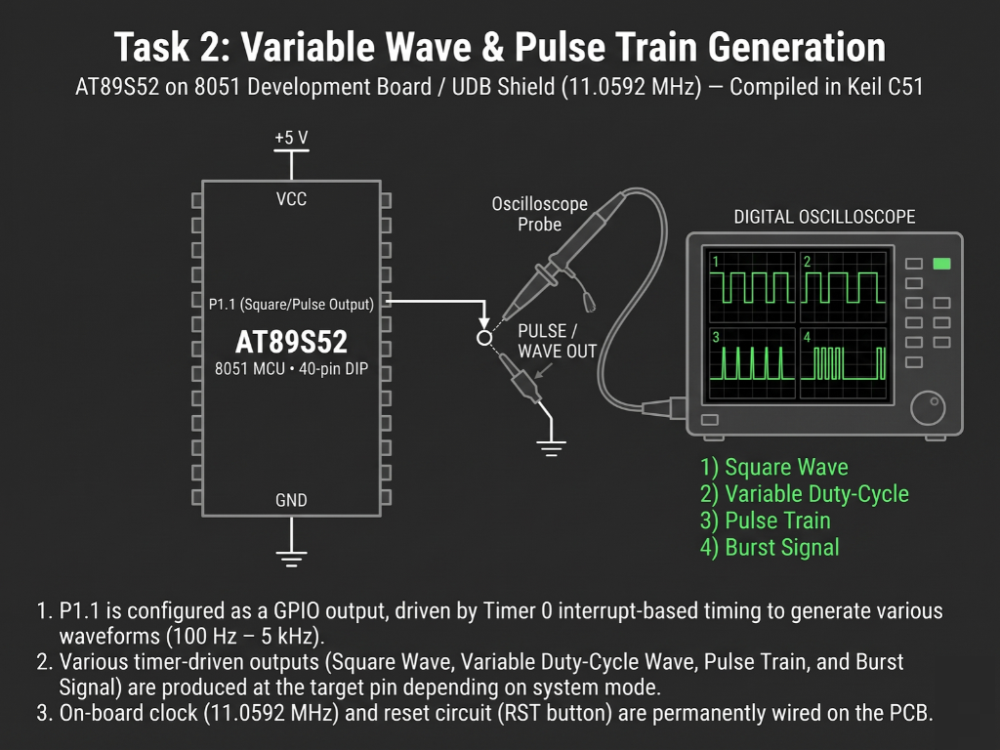

# Continuous Lab Evaluation-5B.4

**EXP:** Continuous Lab Evaluation-5B.4  
**DATE:** 01/09/2026  
**NAME OF EXP:** Hardware Timer and Interrupt-Based Timing — Periodic Pulse Train Generation  
**HARDWARE SETUP / PLATFORM:** Keil C51 + AMOTECH LABS 8051 Development Board / UDB Shield (AT89S52, 11.0592 MHz) + Oscilloscope Probe (`P1.1`)  
**TASK NO:** 5B.4  

---

### Circuit Diagram


---

### Core Logic

* **1. SFR Inclusion, Output Pin Mapping & Frame Counter**
  Includes `<reg52.h>` for AT89S52 Special Function Register definitions, maps `P1.1` to `OUTPUT` for oscilloscope measurement, and declares an 8-slot frame counter (`count`) to track discrete time intervals within each pulse cycle.
  ```c
  #include <reg52.h>

  sbit OUTPUT = P1^1;

  unsigned char count = 0;
  ```

* **2. Timer 1 Mode 1 `1 ms` Tick Configuration**
  Configures Timer 1 in 16-bit Mode 1 (`TMOD = 0x10`) with preload values `TH1 = 0xFC` and `TL1 = 0x66` (`65536 - 922 = 64614`, generating a `1 ms` interrupt interval at `11.0592 MHz`), enables `ET1` and `EA`, and starts `TR1` while keeping the `while(1)` super-loop completely non-blocking.
  ```c
  void main(void)
  {
      OUTPUT = 0;

      TMOD = 0x10;

      TH1 = 0xFC;
      TL1 = 0x66;

      ET1 = 1;
      EA = 1;
      TR1 = 1;

      while(1)
      {
      }
  }
  ```

* **3. Narrow-Duty Pulse-Train State Machine (`timer1_ISR`)**
  Inside `timer1_ISR` (`interrupt 3`), reloads `TH1` and `TL1` (`0xFC66`) every `1 ms` and drives `OUTPUT` HIGH exclusively during slot `count == 0` (`1 ms`) while holding it LOW across slots `1` through `7` (`7 ms`), producing a clean `12.5%` duty-cycle (`125 Hz`) periodic pulse train on `P1.1`.
  ```c
  void timer1_ISR(void) interrupt 3
  {
      TH1 = 0xFC;
      TL1 = 0x66;

      if(count == 0)
      {
          OUTPUT = 1;
      }
      else
      {
          OUTPUT = 0;
      }

      count++;

      if(count >= 8)
      {
          count = 0;
      }
  }
  ```

---

### Inference
Subdividing an `8 ms` period into eight `1 ms` Timer 1 interrupt slots (`0xFC66` reload at `11.0592 MHz`) generated a crisp, repeatable `12.5%` duty-cycle (`125 Hz`) pulse train on `P1.1`. Observing the waveform on the digital oscilloscope confirmed sharp `1 ms` active pulses separated by consistent `7 ms` low intervals with zero blocking overhead in the main program loop.