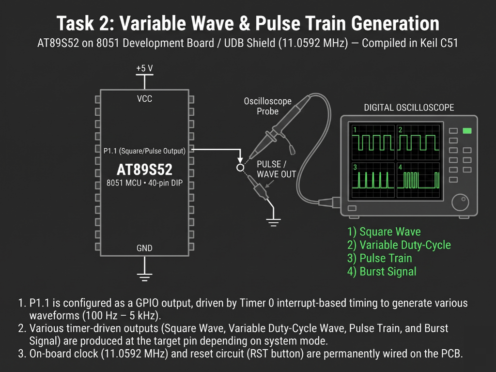

# Continuous Lab Evaluation-5B.5

**EXP:** Continuous Lab Evaluation-5B.5  
**DATE:** 01/09/2026  
**NAME OF EXP:** Hardware Timer and Interrupt-Based Timing — Gated Burst Signal Generation  
**HARDWARE SETUP / PLATFORM:** Keil C51 + AMOTECH LABS 8051 Development Board / UDB Shield (AT89S52, 11.0592 MHz) + Oscilloscope Probe (`P1.1`)  
**TASK NO:** 5B.5  

---

### Circuit Diagram


---

### Core Logic

* **1. SFR Inclusion, Output Pin Mapping & Burst Cycle Counter**
  Includes `<reg52.h>` for AT89S52 Special Function Register definitions, maps `P1.1` to `OUTPUT` for oscilloscope probing, and defines a 30-slot state counter (`count`) to partition active pulse bursts from quiet idle intervals.
  ```c
  #include <reg52.h>

  sbit OUTPUT = P1^1;

  unsigned char count = 0;
  ```

* **2. Timer 1 Mode 1 `1 ms` Tick Initialization**
  Configures Timer 1 in 16-bit Mode 1 (`TMOD = 0x10`) with reload values `TH1 = 0xFC` and `TL1 = 0x66` (`65536 - 922 = 64614`, producing a `1 ms` interrupt interval at `11.0592 MHz`), enables `ET1` and `EA`, and starts `TR1` while leaving the main `while(1)` loop completely non-blocking.
  ```c
  void main(void)
  {
      OUTPUT = 0;

      TMOD = 0x10;

      TH1 = 0xFC;
      TL1 = 0x66;

      ET1 = 1;
      EA = 1;
      TR1 = 1;

      while(1)
      {
      }
  }
  ```

* **3. Gated Burst & Quiet-Interval State Machine (`timer1_ISR`)**
  Inside `timer1_ISR` (`interrupt 3`), reloads `TH1` and `TL1` (`0xFC66`) every `1 ms` across a `30 ms` frame (`count = 0..29`). During active burst windows (`count < 10` and `count >= 20`), `OUTPUT` toggles every `1 ms` (`500 Hz` carrier), while during the middle gating window (`10 <= count < 20`), `OUTPUT` is forced LOW (`0`) for `10 ms` to form distinct gated pulse packets on `P1.1`.
  ```c
  void timer1_ISR(void) interrupt 3
  {
      TH1 = 0xFC;
      TL1 = 0x66;

      if(count < 10)
      {
          OUTPUT = ~OUTPUT;
      }
      else if(count < 20)
      {
          OUTPUT = 0;
      }
      else
      {
          OUTPUT = ~OUTPUT;
      }

      count++;

      if(count >= 30)
      {
          count = 0;
      }
  }
  ```

---

### Inference
Partitioning a `30 ms` Timer 1 interrupt sequence (`0xFC66` reload at `11.0592 MHz`) into active toggling windows and a `10 ms` low-gating interval generated a clean, repeatable burst waveform on `P1.1`. Capturing the output on the digital oscilloscope verified sharp `500 Hz` pulse packets separated by deterministic `10 ms` silent gaps without blocking the main program loop.