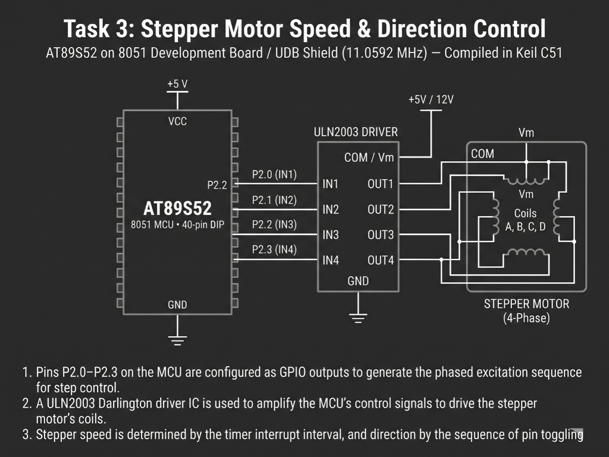

# Continuous Lab Evaluation-5C

**EXP:** Continuous Lab Evaluation-5C  
**DATE:** 01/09/2026  
**NAME OF EXP:** Hardware Timer and Interrupt-Based Timing — Stepper Motor Speed & Direction Control  
**HARDWARE SETUP / PLATFORM:** Keil C51 + AMOTECH LABS 8051 Development Board / UDB Shield (AT89S52, 11.0592 MHz) + ULN2003 Darlington Driver + 4-Phase Unipolar Stepper Motor + 4x4 Matrix Keypad  
**TASK NO:** 5C  

---

### Circuit Diagram


---

### Core Logic

* **1. SFR Inclusion & Motor Control State Variables**
  Includes `<reg51.h>` for AT89S52 Special Function Register definitions and initializes global state variables for the Timer 0 tick accumulator (`timer_count`), dynamic speed prescaler (`step_interval`), and the 4-phase wave-drive coil excitation bitmask (`coil = 0x08`, starting at phase `1000`).
  ```c
  #include <reg51.h>

  unsigned char timer_count = 0; 
  unsigned char step_interval = 1;
  unsigned char coil = 0x08; // Initial coil state for stepper motor
  ```

* **2. 4-Phase Wave-Drive Excitation Sequencer (`step_motor`)**
  Right-shifts the active coil bit across the lower nibble (`0x08 → 0x04 → 0x02 → 0x01`, corresponding to `1000 → 0100 → 0010 → 0001`) and wraps back to `0x08` to continuously energize the ULN2003 Darlington driver inputs and rotate the 4-phase unipolar stepper motor step-by-step.
  ```c
  void step_motor(void)
  {
      if (coil == 0x01)
      {
          coil = 0x08;
      } else {
          coil = coil >> 1;
      }

      P1 = coil;
  }
  ```

* **3. Matrix Keypad Speed Selector (`keypad_scan` & `set_speed`)**
  Scans the `4x4` matrix keypad on Port 2 (`rowPin` on `P2.7–P2.4`, `colPin` on `P2.3–P2.0`) inside the main loop without blocking timer execution, mapping key presses `1`, `2`, and `3` via `set_speed()` to **Fast** (`step_interval = 1`, `10 ms/step`), **Medium** (`step_interval = 5`, `50 ms/step`), and **Slow** (`step_interval = 10`, `100 ms/step`) rotational speeds.
  ```c
  void set_speed(int key)
  {
      switch(key)
      {
          case 1: step_interval = 1; break;   // Fast: 10 ms/step
          case 2: step_interval = 5; break;   // Medium: 50 ms/step
          case 3: step_interval = 10; break;  // Slow: 100 ms/step
      }
  }
  ```

* **4. Timer 0 Mode 1 `10 ms` Base & Prescaled Step ISR (`timer0_ISR`)**
  Configures Timer 0 in 16-bit Mode 1 (`TMOD = 0x01`) with preload `TH0 = 0xDC` and `TL0 = 0x00` (`65536 - 9216 = 56320`, generating a `10 ms` tick at `11.0592 MHz`). Inside `timer0_ISR` (`interrupt 1`), `timer_count` increments every `10 ms` and triggers `step_motor()` whenever `timer_count >= step_interval`.
  ```c
  void timer0_ISR(void) interrupt 1
  {
      TH0 = 0xDC;
      TL0 = 0x00;

      timer_count++;
      if(timer_count >= step_interval) {
          timer_count = 0;
          step_motor(); // Call the step motor function
      }
  }
  ```

---

### Inference
Using Timer 0 in 16-bit Mode 1 (`0xDC00` reload at `11.0592 MHz`) to generate a precise `10 ms` interrupt base allowed deterministic, non-blocking stepping of the 4-phase unipolar stepper motor through the ULN2003 Darlington driver. Adjusting `step_interval` dynamically via matrix keypad inputs (`1`, `2`, `3`) smoothly switched the excitation rate between `10 ms/step` (Fast), `50 ms/step` (Medium), and `100 ms/step` (Slow) while cycling the `1000 → 0100 → 0010 → 0001` coil sequence without blocking main-loop scanning.