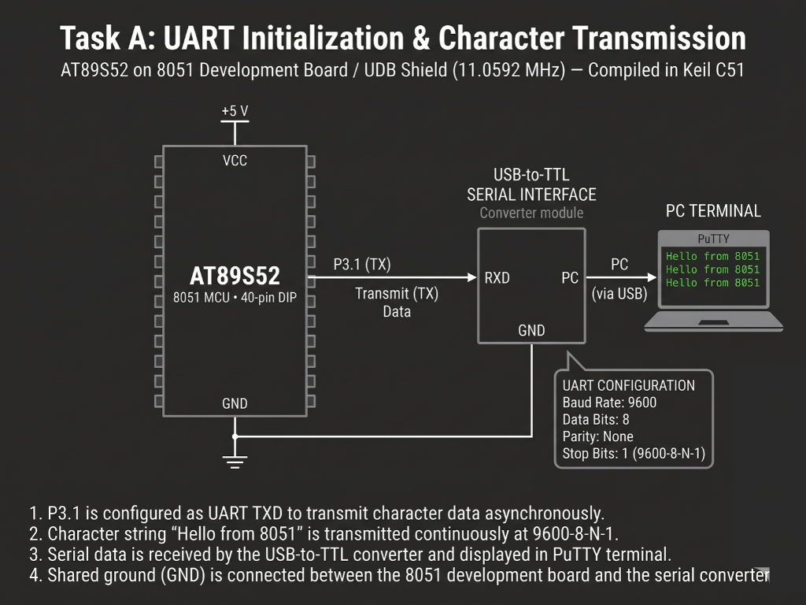

# Continuous Lab Evaluation-6A

**EXP:** Continuous Lab Evaluation-6A  
**DATE:** 17/08/2026  
**NAME OF EXP:** UART Driver and Serial Debugging — UART Initialization and Character Transmission  
**HARDWARE SETUP / PLATFORM:** Keil C51 + AMOTECH LABS 8051 Development Board / UDB Shield (AT89S52, 11.0592 MHz) + USB-to-TTL Serial Interface Converter (`P3.1 TX` to `RXD`, shared `GND`) + PC Terminal (PuTTY, `9600-8-N-1`)  
**TASK NO:** 6A  

---

### Circuit Diagram


---

### Core Logic

* **1. SFR Inclusion & Transmit String Buffer**
  Includes `<reg51.h>` for AT89S52 Special Function Register definitions and stores the null-terminated transmission string `message[] = "hello\r\n"` alongside a buffer `index` tracker for sequential byte streaming over UART `TXD` (`P3.1`).
  ```c
  #include <reg51.h> 

  char message[] = "hello\r\n";
  unsigned char index = 0;
  ```

* **2. UART `9600-8-N-1` & Timer 1 Mode 2 Baud Rate Initialization**
  Configures the serial port in Mode 1 (`SCON = 0x50`: 8-bit variable-baud UART with reception enabled, 1 start bit, 1 stop bit, no parity), sets Timer 1 in 8-bit auto-reload Mode 2 (`TMOD |= 0x20`) with `TH1 = 0xFD` for an exact `9600 bps` baud rate at `11.0592 MHz`, starts `TR1`, enables serial and global interrupts (`ES = 1`, `EA = 1`), and primes `SBUF` with the first character.
  ```c
  void main() {
      SCON = 0x50;   // 8-bit UART mode, REN enabled
      TMOD |= 0x20;  // Timer 1 in Mode 2 (8-bit auto-reload)
      TH1 = 0xFD;    // 9600 baud rate at 11.0592 MHz
      TR1 = 1;       // Start Timer 1
      ES = 1;        // Enable serial interrupt
      EA = 1;        // Enable global interrupts

      SBUF = message[index++]; // Trigger initial byte transmission
      while(1) {
          // Non-blocking main loop
      }
  }
  ```

* **3. Non-Blocking Transmit-Complete Interrupt Service Routine (`serial_interrupt`)**
  Handles UART vector `interrupt 4` whenever a frame finishes shifting out of `P3.1` (`TI == 1`), clears `TI`, wraps `index` back to `0` after all `7` characters (`"hello\r\n"`) are transmitted, and loads the next byte into `SBUF` continuously without blocking the main loop.
  ```c
  void serial_interrupt(void) interrupt 4 {
      if(TI) {
          TI = 0; // Clear transmit interrupt flag
          if(index == 7) {
              index = 0; // Reset index after sending full message
          }
          SBUF = message[index++]; // Load next character
      }
  }
  ```

---

### Inference
Configuring the AT89S52 UART in 8-bit Mode 1 (`SCON = 0x50`) clocked by Timer 1 in 8-bit auto-reload Mode 2 (`TH1 = 0xFD` at `11.0592 MHz`) established a drift-free `9600-8-N-1` asynchronous serial link through `P3.1` (`TXD`) and the USB-to-TTL converter. Triggering sequential byte loads inside the `TI` interrupt service routine streamed the message continuously to the PuTTY terminal on the PC while keeping the main loop completely non-blocking.