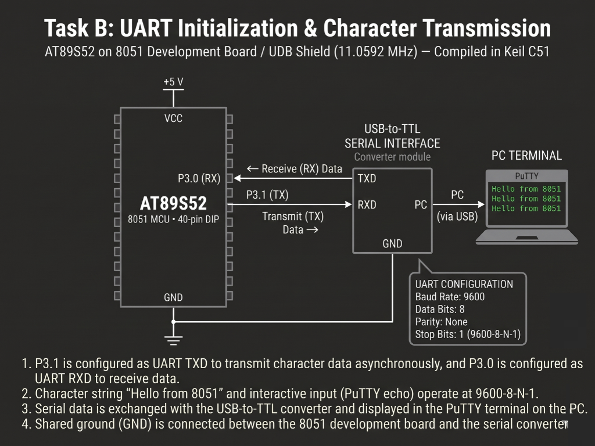

# Continuous Lab Evaluation-6B

**EXP:** Continuous Lab Evaluation-6B  
**DATE:** 17/08/2026  
**NAME OF EXP:** UART Driver and Serial Debugging — Interactive UART Echo  
**HARDWARE SETUP / PLATFORM:** Keil C51 + AMOTECH LABS 8051 Development Board / UDB Shield (AT89S52, 11.0592 MHz) + USB-to-TTL Serial Interface Converter (`P3.0 RX` to `TXD`, `P3.1 TX` to `RXD`, shared `GND`) + PC Terminal (PuTTY, `9600-8-N-1`)  
**TASK NO:** 6B  

---

### Circuit Diagram


---

### Core Logic

* **1. SFR Inclusion & Character Buffer Variable**
  Includes `<reg51.h>` for AT89S52 Special Function Register definitions and declares a global byte variable `c` to hold each incoming character received over `P3.0` (`RXD`) before echoing it back over `P3.1` (`TXD`).
  ```c
  #include <reg51.h> 

  unsigned char c;
  ```

* **2. Full-Duplex `9600-8-N-1` UART & Timer 1 Initialization (`init`)**
  Configures the serial port in 8-bit Mode 1 (`SCON = 0x50`) with receiver enable (`REN = 1`), sets Timer 1 in 8-bit auto-reload Mode 2 (`TMOD |= 0x20`) with `TH1 = 0xFD` for an exact `9600 bps` baud rate at `11.0592 MHz`, starts `TR1`, and enables serial and global interrupts (`ES = 1`, `EA = 1`) while keeping `main()` completely non-blocking.
  ```c
  void init() {
      SCON = 0x50;   // 8-bit UART mode, reception enabled
      TMOD |= 0x20;  // Timer 1 in Mode 2 (8-bit auto-reload)
      TH1 = 0xFD;    // 9600 baud rate at 11.0592 MHz
      TR1 = 1;       // Start Timer 1
      ES = 1;        // Enable serial interrupt
      EA = 1;        // Enable global interrupts
  }

  void main() {
      init();

      while(1) {
          // Non-blocking main super-loop
      }
  }
  ```

* **3. Interrupt-Driven Receive-and-Echo Handler (`serial_interrupt`)**
  Services UART vector `interrupt 4` for both receive and transmit events: when `RI` triggers upon receiving a byte on `P3.0`, it clears `RI`, reads `c = SBUF`, and immediately writes `SBUF = c` to transmit the character back via `P3.1`; when `TI` triggers after transmission completes, it clears `TI` cleanly.
  ```c
  void serial_interrupt(void) interrupt 4 {
      if(RI) {
          RI = 0;    // Clear receive interrupt flag
          c = SBUF;  // Read received character
          SBUF = c;  // Echo back the received character
      }

      if(TI) {
          TI = 0;    // Clear transmit interrupt flag
      }
  }
  ```

---

### Inference
Cross-connecting `P3.0` (`RXD`) and `P3.1` (`TXD`) on the `11.0592 MHz` AT89S52 board to the USB-to-TTL serial converter with Timer 1 configured at `TH1 = 0xFD` (`9600-8-N-1`) enabled reliable, full-duplex asynchronous serial communication. Handling `RI` and `TI` flags inside `serial_interrupt` echoed every character typed in PuTTY (such as `ABC123`) back to the PC terminal instantaneously without blocking the main program loop.