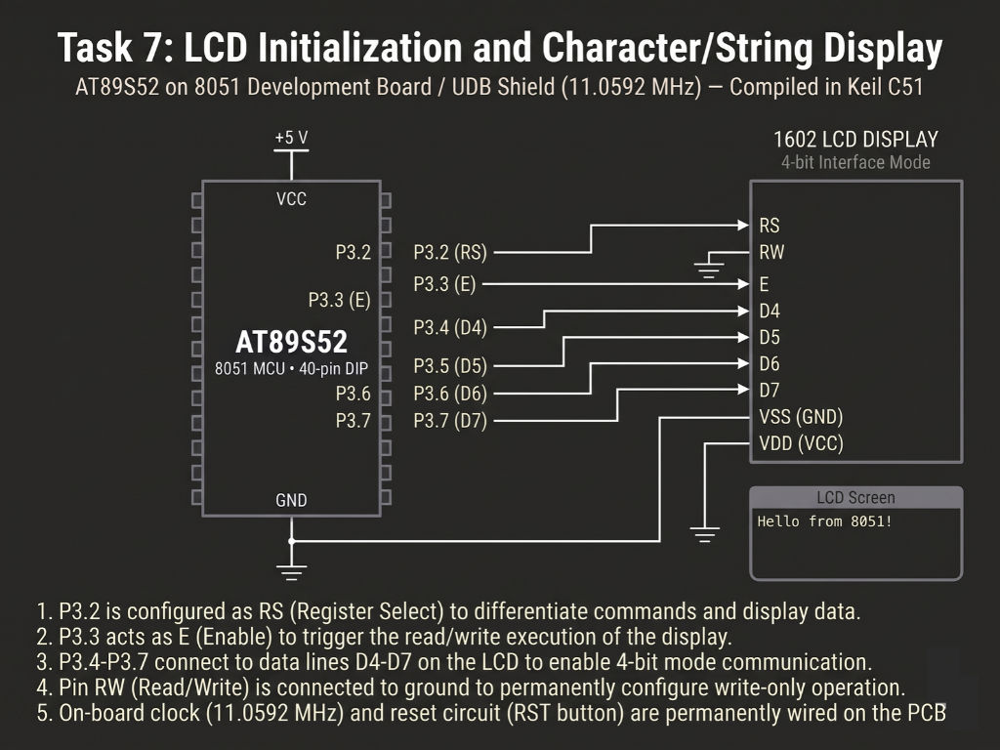

# Continuous Lab Evaluation-7A

**EXP:** Continuous Lab Evaluation-7A  
**DATE:** 24/08/2026  
**NAME OF EXP:** 16×2 LCD Driver Development and Dynamic Display Control — LCD Initialization and Character/String Display  
**HARDWARE SETUP / PLATFORM:** Keil C51 + AMOTECH LABS 8051 Development Board / UDB Shield (AT89S52, 11.0592 MHz) + HD44780-Compatible 16×2 Character LCD (4-bit mode, `RW` grounded)  
**TASK NO:** 7A  

---

### Circuit Diagram


---

### Core Logic

* **1. SFR Inclusion & 4-Bit Control/Data Pin Mapping**
  Includes `<reg52.h>` for AT89S52 Special Function Register definitions and maps the upper data nibble (`D4–D7`) along with the Register Select (`RS`) and Enable (`EN`) control lines using `sbit` while holding `RW` grounded for write-only operation.
  ```c
  #include <reg52.h>

  #define LCD_PORT P2

  sbit RS = P2^0;
  sbit EN = P2^1;
  ```

* **2. 4-Bit Nibble Latching & Command/Data Dispatch (`lcd_nibble`, `lcd_cmd`, `lcd_data`)**
  Masks the upper nibble onto `LCD_PORT` (`(LCD_PORT & 0x0F) | (value & 0xF0)`) and pulses `EN` high-to-low to latch each 4-bit half-byte. `lcd_cmd()` (`RS = 0`) and `lcd_data()` (`RS = 1`) split every 8-bit instruction or ASCII character into high and low nibbles sequentially.
  ```c
  void lcd_nibble(unsigned char value)
  {
      LCD_PORT = (LCD_PORT & 0x0F) | (value & 0xF0);

      EN = 1;
      delay(1);
      EN = 0;
  }

  void lcd_cmd(unsigned char cmd)
  {
      RS = 0;
      lcd_nibble(cmd);
      lcd_nibble(cmd << 4);
      delay(2);
  }

  void lcd_data(unsigned char dat)
  {
      RS = 1;
      lcd_nibble(dat);
      lcd_nibble(dat << 4);
      delay(2);
  }
  ```

* **3. HD44780 4-Bit Reset & Configuration Sequence (`lcd_init`)**
  Executes the datasheet wake-up sequence (`0x30` three times followed by `0x20` to enter 4-bit bus mode), then issues `0x28` (4-bit, 2-line, 5×7 font), `0x0C` (display ON, cursor OFF), `0x06` (auto-increment cursor), and `0x01` (clear display).
  ```c
  void lcd_init(void)
  {
      delay(20);
      RS = 0;
      lcd_nibble(0x30); delay(5);
      lcd_nibble(0x30); delay(1);
      lcd_nibble(0x30); delay(1);
      lcd_nibble(0x20);

      lcd_cmd(0x28);  // 4-bit, 2-line mode
      lcd_cmd(0x0C);  // Display ON, cursor OFF
      lcd_cmd(0x06);  // Increment cursor
      lcd_cmd(0x01);  // Clear display
      delay(5);
  }
  ```

* **4. DDRAM Cursor Addressing & Multi-Row String/Character Output (`lcd_goto`, `lcd_puts`)**
  Calculates DDRAM base offsets (`0x80 + column` for row `0`, `0xC0 + column` for row `1`) to position the cursor across both lines of the 16×2 display, printing `"HELLO WORLD"` on the first row and `"AT89S52"` alongside the single character `'A'` on the second row.
  ```c
  void lcd_goto(unsigned char row, unsigned char column)
  {
      if(row == 0)
          lcd_cmd(0x80 + column);
      else
          lcd_cmd(0xC0 + column);
  }

  void main(void)
  {
      lcd_init();

      lcd_goto(0, 0);
      lcd_puts("HELLO WORLD");

      lcd_goto(1, 0);
      lcd_puts("AT89S52");

      lcd_goto(1, 10);
      lcd_data('A');

      while(1) { }
  }
  ```

---

### Inference
Implementing a bare-metal HD44780 4-bit GPIO driver in Keil C51 on the `11.0592 MHz` AT89S52 development board reliably initialized the 16×2 LCD in 2-line mode using only six I/O pins (`RS`, `EN`, and `D4–D7`) with `RW` tied to ground. Sequential high/low nibble latching and DDRAM row addressing (`0x80` and `0xC0`) cleanly rendered both multi-character strings and individual characters across both display rows without external libraries.