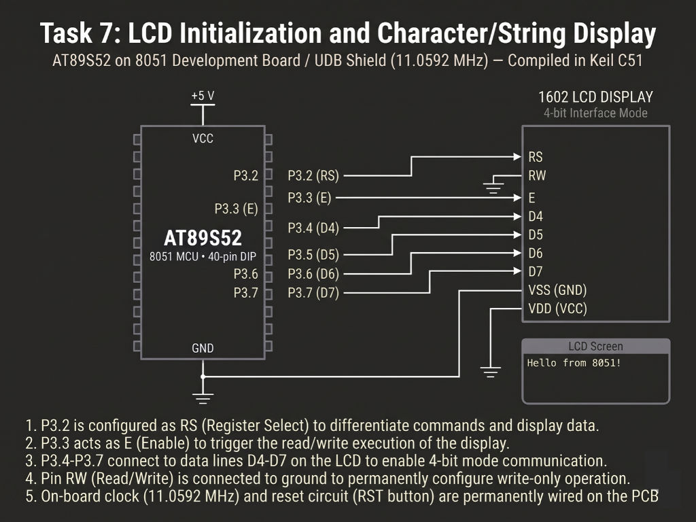

# Continuous Lab Evaluation-7B

**EXP:** Continuous Lab Evaluation-7B  
**DATE:** 24/08/2026  
**NAME OF EXP:** 16×2 LCD Driver Development and Dynamic Display Control — Cursor Positioning and Dynamic Value Update  
**HARDWARE SETUP / PLATFORM:** Keil C51 + AMOTECH LABS 8051 Development Board / UDB Shield (AT89S52, 11.0592 MHz) + HD44780-Compatible 16×2 Character LCD (4-bit mode, `RW` grounded)  
**TASK NO:** 7B  

---

### Circuit Diagram


---

### Core Logic

* **1. 4-Bit HD44780 LCD Driver & DDRAM Cursor Addressing (`lcd_goto`, `lcd_puts`)**
  Maps the 4-bit data bus (`D4–D7`) along with `RS` and `EN` (with `RW` tied to ground), initializes the 16×2 LCD in 2-line mode (`0x28`), and uses `lcd_goto(row, column)` to jump directly to DDRAM row base offsets (`0x80 + column` for Row 0, `0xC0 + column` for Row 1) before streaming strings via `lcd_puts()`.
  ```c
  void lcd_goto(unsigned char row, unsigned char column)
  {
      if(row == 0)
          lcd_cmd(0x80 + column);
      else
          lcd_cmd(0xC0 + column);
  }

  void lcd_puts(char *str)
  {
      while(*str)
      {
          lcd_data(*str);
          str++;
      }
  }
  ```

* **2. Unsigned Integer-to-ASCII Conversion (`lcd_print_number`)**
  Extracts decimal digits of an unsigned integer (`0–9999`) via repeated modulo-10 division (`(num % 10) + '0'`) into a temporary `digits[5]` stack, handles the zero edge case directly, and outputs characters in reverse order so multi-digit values render left-to-right on the LCD.
  ```c
  void lcd_print_number(unsigned int num)
  {
      unsigned char digits[5];
      unsigned char i = 0;

      if(num == 0)
      {
          lcd_data('0');
          return;
      }

      while(num > 0)
      {
          digits[i] = (num % 10) + '0';
          num = num / 10;
          i++;
      }

      while(i > 0)
      {
          i--;
          lcd_data(digits[i]);
      }
  }
  ```

* **3. Flicker-Free In-Place Counter Refresh Loop (`main`)**
  Writes the static header `"Counter Value:"` once on Row 0, then continuously updates Row 1 (`"Value: "`) by overwriting the numeric field with five spaces (`"     "`), repositioning the cursor to column `7` (`lcd_goto(1, 7)`), printing the incremented `count` (`0` to `9999` wrap-around), and pacing updates with `delay(500)` without clearing the entire screen.
  ```c
  void main(void)
  {
      unsigned int count = 0;

      lcd_init();
      lcd_goto(0, 0);
      lcd_puts("Counter Value:");

      while(1)
      {
          lcd_goto(1, 0);
          lcd_puts("Value: ");
          lcd_puts("     ");       // Overwrite old digits in place
          lcd_goto(1, 7);          // Reposition cursor to value field
          lcd_print_number(count);

          count++;
          if(count > 9999) count = 0;
          delay(500);
      }
  }
  ```

---

### Inference
Combining DDRAM cursor positioning (`lcd_goto`) with modulo-based integer-to-ASCII conversion (`lcd_print_number`) enabled smooth, real-time numeric updates on the 16×2 LCD in 4-bit mode without issuing full-screen clear commands (`0x01`). Overwriting only the targeted character cells on Row 1 (`"Value: "`) eliminated display flicker while cleanly rolling the counter from `0` through `9999` on the `11.0592 MHz` AT89S52 board.