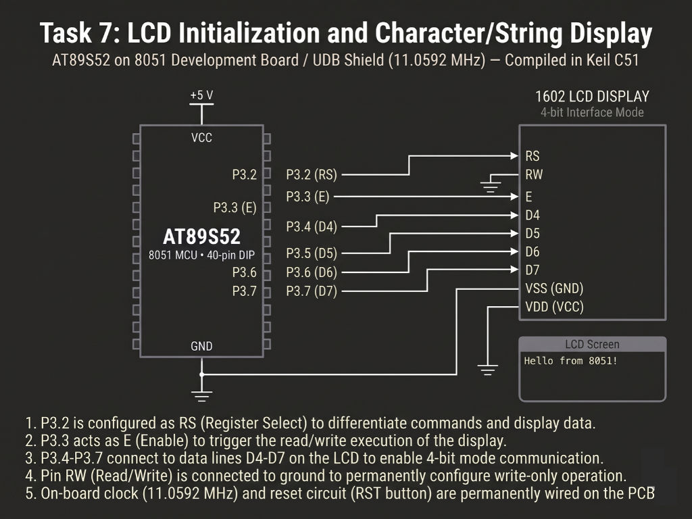

# Continuous Lab Evaluation-7C

**EXP:** Continuous Lab Evaluation-7C  
**DATE:** 24/08/2026  
**NAME OF EXP:** 16×2 LCD Driver Development and Dynamic Display Control — 4×4 Keypad-Based Character Movement  
**HARDWARE SETUP / PLATFORM:** Keil C51 + AMOTECH LABS 8051 Development Board / UDB Shield (AT89S52, 11.0592 MHz) + HD44780-Compatible 16×2 Character LCD (4-bit mode, `RW` grounded) + 4×4 Matrix Keypad (`P1.0–P1.7`)  
**TASK NO:** 7C

---

### Circuit Diagram


---

### Core Logic

* **1. 4-Bit LCD Driver & Matrix Keypad Port Allocation**
  Drives the 16×2 character LCD in 4-bit mode (`RS`, `EN`, and `D4–D7` with `RW` tied to ground), while assigning Port 1 to the `4×4` matrix keypad (`P1.0–P1.3` as row outputs and `P1.4–P1.7` as column inputs).
  ```c
  #define LCD_PORT P2

  sbit RS = P2^0;
  sbit EN = P2^1;
  // Keypad mapped to Port 1: Rows P1.0-P1.3, Columns P1.4-P1.7
  ```

* **2. Row-Scanning `4×4` Keypad Decoder (`keypad_getkey`)**
  Sequentially drives each lower-nibble row pin (`P1.0–P1.3`) LOW (`P1 = 0xF0 | (0x0F & ~(1 << row))`), samples the upper-nibble column pins (`0x10 << col`), and maps active coordinates to the `4×4` character lookup table (`keys[4][4]`).
  ```c
  char keypad_getkey(void)
  {
      unsigned char row, col, value;
      char keys[4][4] = {
          {'1','2','3','A'},
          {'4','5','6','B'},
          {'7','8','9','C'},
          {'*','0','#','D'}
      };

      for(row = 0; row < 4; row++)
      {
          P1 = 0xFF;
          P1 = 0xF0 | (0x0F & ~(1 << row));
          value = P1;

          for(col = 0; col < 4; col++)
          {
              if((value & (0x10 << col)) == 0)
                  return keys[row][col];
          }
      }
      return 0;
  }
  ```

* **3. Debounced Directional Grid Navigation & In-Place Rendering (`main`)**
  Places the marker `'X'` at `(0, 0)` after `lcd_init()`, validates key presses across a `20 ms` debounce window, erases the previous cell (`' '`), updates `(row, col)` within the `2 × 16` display bounds using directional keys `'2'` (Up), `'8'` (Down), `'4'` (Left), and `'6'` (Right), renders `'X'` at the new DDRAM coordinate, and waits for key release.
  ```c
  if(keypad_getkey() == key)
  {
      lcd_goto(row, col);
      lcd_data(' '); // Erase old character

      if(key == '2' && row > 0)       row--; // Move Up
      else if(key == '8' && row < 1)  row++; // Move Down
      else if(key == '4' && col > 0)  col--; // Move Left
      else if(key == '6' && col < 15) col++; // Move Right

      lcd_goto(row, col);
      lcd_data('X'); // Display at new position

      while(keypad_getkey() != 0);
      delay(20);
  }
  ```

---

### Inference
Integrating the `4×4` matrix keypad on Port 1 with the 4-bit HD44780 16×2 LCD driver on the `11.0592 MHz` AT89S52 board produced a responsive, interactive cursor-navigation system. Software debouncing (`20 ms`) paired with targeted cell erasure and DDRAM repositioning (`lcd_goto`) allowed keys `'2'`, `'8'`, `'4'`, and `'6'` to move the character `'X'` smoothly across all `32` positions of the display without boundary overflow or flicker.