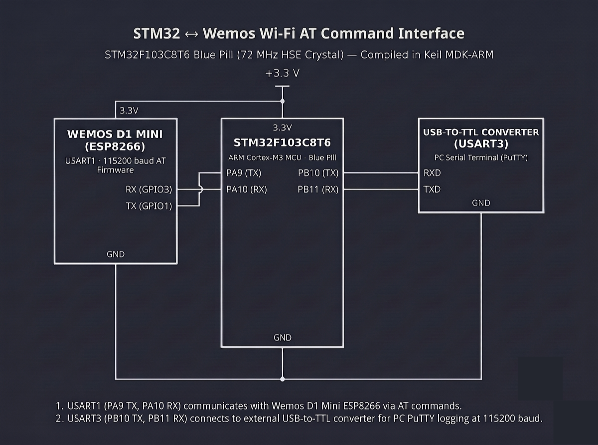

# Continuous Lab Evaluation-10A

**EXP:** Continuous Lab Evaluation-10A  
**DATE:** 05/10/2026  
**NAME OF EXP:** STM32–Wemos Wi-Fi Modem Interface Using AT Commands — Establish STM32 ↔ Wemos UART Communication  
**HARDWARE SETUP / PLATFORM:** STM32CubeMX + Keil MDK-ARM + STM32F103C8T6 Blue Pill (72 MHz HSE Crystal) + Wemos D1 Mini (ESP8266 AT Firmware) + USB-to-TTL Serial Converter (`USART1` & `USART3` at `115200-8-N-1`) + PC Serial Terminal (PuTTY)  
**TASK NO:** 10A  

---

### Circuit Diagram


---

### Core Logic

* **1. Dual-UART Peripheral Initialization (`MX_USART1_UART_Init`, `MX_USART3_UART_Init`)**
  Configures both `USART1` (`PA9` TX, `PA10` RX) and `USART3` (`PB10` TX, `PB11` RX) via `HAL_UART_Init()` at `115200 bps` (`8-bit` word length, `1` stop bit, no parity, full-duplex `UART_MODE_TX_RX`) to bridge AT command traffic between the Wemos D1 Mini (ESP8266) and the PC serial console.
  ```c
  huart1.Instance = USART1;
  huart1.Init.BaudRate = 115200;
  huart1.Init.WordLength = UART_WORDLENGTH_8B;
  huart1.Init.StopBits = UART_STOPBITS_1;
  huart1.Init.Parity = UART_PARITY_NONE;
  huart1.Init.Mode = UART_MODE_TX_RX;
  HAL_UART_Init(&huart1);

  huart3.Instance = USART3;
  huart3.Init.BaudRate = 115200;
  huart3.Init.WordLength = UART_WORDLENGTH_8B;
  huart3.Init.StopBits = UART_STOPBITS_1;
  huart3.Init.Parity = UART_PARITY_NONE;
  huart3.Init.Mode = UART_MODE_TX_RX;
  HAL_UART_Init(&huart3);
  ```

* **2. AT Command Transmission & Response Forwarding (`main`)**
  Waits `1000 ms` (`HAL_Delay(1000)`) for the ESP8266 modem to finish booting, transmits `"AT\r\n"` over `USART3` (`HAL_UART_Transmit(&huart3, ...)`), captures the incoming modem response into `rx_buffer[64]` within a `2000 ms` timeout window (`HAL_UART_Receive(&huart3, ...)`), and forwards the received characters (`"OK"`)—or a timeout diagnostic message—to the PC terminal over `USART1`.
  ```c
  char at_cmd[] = "AT\r\n";
  uint8_t rx_buffer[64] = {0};

  HAL_Delay(1000); // Allow Wemos D1 Mini to boot

  HAL_UART_Transmit(&huart3, (uint8_t *)at_cmd, strlen(at_cmd), 1000);
  HAL_StatusTypeDef status = HAL_UART_Receive(&huart3, rx_buffer, sizeof(rx_buffer) - 1, 2000);

  if (status == HAL_OK || rx_buffer[0] != '\0') {
      HAL_UART_Transmit(&huart1, rx_buffer, strlen((char *)rx_buffer), HAL_MAX_DELAY);
      HAL_UART_Transmit(&huart1, (uint8_t *)"\r\n", 2, HAL_MAX_DELAY);
  } else {
      char err_msg[] = "Timeout / No Response\r\n";
      HAL_UART_Transmit(&huart1, (uint8_t *)err_msg, strlen(err_msg), HAL_MAX_DELAY);
  }
  ```

---

### Inference
Configuring dual `115200-8-N-1` UART interfaces (`USART1` and `USART3`) on the STM32F103C8T6 Blue Pill established reliable bidirectional serial communication with the Wemos D1 Mini (ESP8266) AT firmware. Transmitting `"AT\r\n"` after startup and relaying the received `"OK"` acknowledgment to the PC terminal verified physical TX/RX wiring, shared ground integrity, and baud-rate synchronization prior to Wi-Fi network configuration.