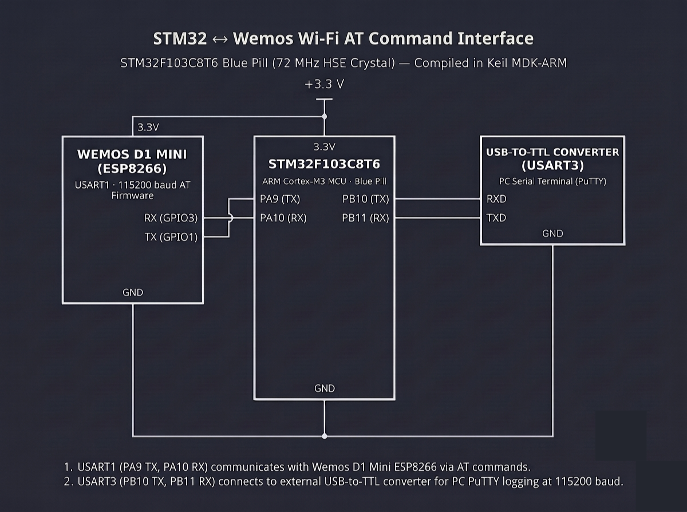

# Continuous Lab Evaluation-10B

**EXP:** Continuous Lab Evaluation-10B  
**DATE:** 05/10/2026  
**NAME OF EXP:** STM32–Wemos Wi-Fi Modem Interface Using AT Commands — Explore the ESP8266 AT Command Interface  
**HARDWARE SETUP / PLATFORM:** STM32CubeMX + Keil MDK-ARM + STM32F103C8T6 Blue Pill (72 MHz HSE Crystal) + Wemos D1 Mini (ESP8266 AT Firmware on `USART1`: `PA9 TX`, `PA10 RX`) + USB-to-TTL Converter (`USART3`: `PB10 TX`, `PB11 RX`) + PC Serial Terminal (PuTTY, `115200-8-N-1`)  
**TASK NO:** 10B  

---

### Circuit Diagram


---

### Core Logic

* **1. Dual-UART Bridge Architecture (`MX_USART1_UART_Init`, `MX_USART3_UART_Init`)**
  Initializes both `USART1` (`PA9` TX, `PA10` RX) and `USART3` (`PB10` TX, `PB11` RX) at `115200-8-N-1` (`UART_MODE_TX_RX`), dedicating `USART1` to direct AT command/response exchange with the Wemos D1 Mini (ESP8266) while routing debug logs and live modem replies to the PC PuTTY console over `USART3`.
  ```c
  huart1.Instance = USART1; // STM32 <-> Wemos D1 Mini (ESP8266)
  huart1.Init.BaudRate = 115200;
  HAL_UART_Init(&huart1);

  huart3.Instance = USART3; // STM32 <-> PC PuTTY Terminal
  huart3.Init.BaudRate = 115200;
  HAL_UART_Init(&huart3);
  ```

* **2. Time-Bounded AT Command Dispatcher & Stream Forwarder (`send_cmds`)**
  Formats a debug banner (`"SENDING\r\n : <cmd>"`) to PuTTY over `USART3`, transmits the raw AT command string to the ESP8266 over `USART1`, and polls `HAL_UART_Receive(&huart1, &rx_byte, 1, 10)` across a configurable `HAL_GetTick()` window (`total_wait_time`) to stream multi-line responses (such as AP scan lists and IP addresses) byte-by-byte to `USART3` without truncation.
  ```c
  void send_cmds(char *cmd, uint32_t total_wait_time) {
      char send[100];
      snprintf(send, sizeof(send), "SENDING\r\n : %s", cmd);

      HAL_UART_Transmit(&huart3, (uint8_t *)send, strlen(send), HAL_MAX_DELAY);
      HAL_UART_Transmit(&huart1, (uint8_t *)cmd, strlen(cmd), HAL_MAX_DELAY);

      uint8_t rx_byte;
      uint32_t overall_start = HAL_GetTick();

      while ((HAL_GetTick() - overall_start) < total_wait_time) {
          if (HAL_UART_Receive(&huart1, &rx_byte, 1, 10) == HAL_OK) {
              HAL_UART_Transmit(&huart3, &rx_byte, 1, HAL_MAX_DELAY);
          }
      }
  }
  ```

* **3. Sequential Wi-Fi Provisioning & Network Query Pipeline (`cmds_10b`)**
  Executes the complete ESP8266 AT command workflow after a `2000 ms` boot delay: verifies modem readiness (`AT`), queries SDK/AT firmware version (`AT+GMR`), configures Wi-Fi Station mode (`AT+CWMODE=1`), scans nearby access points (`AT+CWLAP`), connects to the target Wi-Fi network (`AT+CWJAP="SNUC","snu12345"`), and retrieves the assigned local IP and MAC addresses (`AT+CIFSR`).
  ```c
  void cmds_10b() {
      HAL_Delay(2000);
      send_cmds("AT\r\n", 1000);                         // Check modem response
      HAL_Delay(1000);
      send_cmds("AT+GMR\r\n", 2000);                     // Check firmware version
      HAL_Delay(1000);
      send_cmds("AT+CWMODE=1\r\n", 1000);                // Set Wi-Fi Station mode
      HAL_Delay(1000);
      send_cmds("AT+CWLAP\r\n", 5000);                   // Scan available networks
      HAL_Delay(1000);
      send_cmds("AT+CWJAP=\"SNUC\",\"snu12345\"\r\n", 10000); // Connect to AP
      send_cmds("AT+CIFSR\r\n", 3000);                   // Obtain IP/MAC info
  }
  ```

---

### Inference
Separating modem communication (`USART1`) from PC terminal logging (`USART3`) on the STM32F103C8T6 Blue Pill enabled transparent real-time inspection of every ESP8266 AT command and response on PuTTY. Using a `HAL_GetTick()` time-bounded byte-streaming loop in `send_cmds()` reliably captured variable-length responses—from single-line `OK` acknowledgments to multi-line `AT+CWLAP` network scans and `AT+CIFSR` IP assignments—confirming successful Wi-Fi station association.