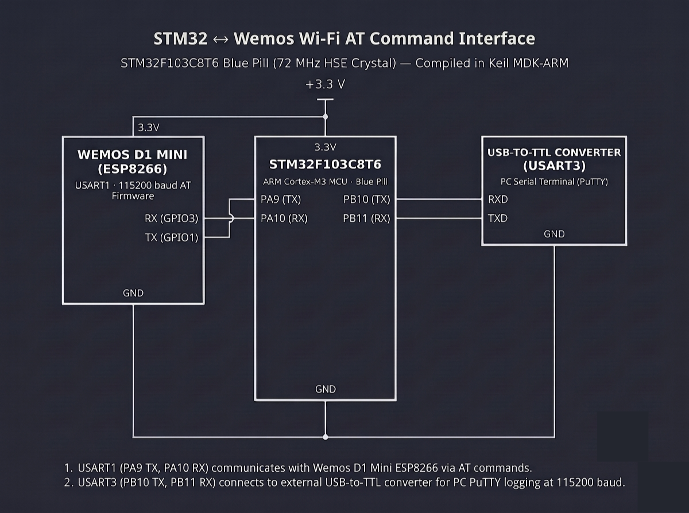

# Continuous Lab Evaluation-10C

**EXP:** Continuous Lab Evaluation-10C  
**DATE:** 05/10/2026  
**NAME OF EXP:** STM32–Wemos Wi-Fi Modem Interface Using AT Commands — Connect Wemos to Wi-Fi Station & Verify Network Status  
**HARDWARE SETUP / PLATFORM:** STM32CubeMX + Keil MDK-ARM + STM32F103C8T6 Blue Pill (72 MHz HSE Crystal) + Wemos D1 Mini (ESP8266 AT Firmware on `USART1`: `PA9 TX`, `PA10 RX`) + USB-to-TTL Converter (`USART3`: `PB10 TX`, `PB11 RX`) + PC Serial Terminal (PuTTY, `115200-8-N-1`)  
**TASK NO:** 10C  

---

### Circuit Diagram


---

### Core Logic

* **1. Dual-UART Initialization (`MX_USART1_UART_Init`, `MX_USART3_UART_Init`)**
  Initializes `USART1` (`PA9` TX, `PA10` RX) and `USART3` (`PB10` TX, `PB11` RX) at `115200-8-N-1` (`UART_MODE_TX_RX`), isolating AT command exchange with the Wemos D1 Mini on `USART1` while streaming formatted diagnostic logs and live responses to PuTTY on `USART3`.
  ```c
  huart1.Instance = USART1; // STM32 <-> Wemos D1 Mini (ESP8266)
  huart1.Init.BaudRate = 115200;
  HAL_UART_Init(&huart1);

  huart3.Instance = USART3; // STM32 <-> PC PuTTY Terminal
  huart3.Init.BaudRate = 115200;
  HAL_UART_Init(&huart3);
  ```

* **2. Time-Bounded AT Command Dispatcher & Byte-Stream Relay (`send_cmds`)**
  Logs each outgoing command to PuTTY over `USART3`, transmits the AT instruction to the ESP8266 over `USART1`, and polls `HAL_UART_Receive(&huart1, &rx_byte, 1, 10)` across `total_wait_time` (`HAL_GetTick()`) so asynchronous multi-stage responses (`WIFI CONNECTED`, `WIFI GOT IP`, `OK`, and `CIFSR` IP strings) stream cleanly to `USART3`.
  ```c
  void send_cmds(char *cmd, uint32_t total_wait_time) {
      char send[100];
      snprintf(send, sizeof(send), "SENDING\r\n : %s", cmd);

      HAL_UART_Transmit(&huart3, (uint8_t *)send, strlen(send), HAL_MAX_DELAY);
      HAL_UART_Transmit(&huart1, (uint8_t *)cmd, strlen(cmd), HAL_MAX_DELAY);

      uint8_t rx_byte;
      uint32_t overall_start = HAL_GetTick();

      while ((HAL_GetTick() - overall_start) < total_wait_time) {
          if (HAL_UART_Receive(&huart1, &rx_byte, 1, 10) == HAL_OK) {
              HAL_UART_Transmit(&huart3, &rx_byte, 1, HAL_MAX_DELAY);
          }
      }
  }
  ```

* **3. Automated Wi-Fi Station Association & Verification Sequence (`cmds_9c_wifi_connect`)**
  Prints a startup test banner on `USART3`, verifies modem readiness (`AT`), configures Station mode (`AT+CWMODE=1`), joins the local Wi-Fi Access Point (`AT+CWJAP="SNUC","snu12345"`) within a `12000 ms` association window, queries the assigned IPv4 and MAC addresses (`AT+CIFSR`), and prints a formatted `VERIFICATION` summary (`WIFI MODE : STATION`, `WIFI STATUS : CONNECTED`).
  ```c
  void cmds_9c_wifi_connect(void)
  {
      HAL_Delay(2000);

      char *banner = "\r\n--- STM32-WiFi MODEM TEST ---\r\n\r\n";
      HAL_UART_Transmit(&huart3, (uint8_t *)banner, strlen(banner), HAL_MAX_DELAY);

      send_cmds("AT\r\n", 1000);
      HAL_Delay(1000);

      send_cmds("AT+CWMODE=1\r\n", 1000);
      HAL_Delay(1000);

      send_cmds("AT+CWJAP=\"SNUC\",\"snu12345\"\r\n", 12000);
      HAL_Delay(1000);

      send_cmds("AT+CIFSR\r\n", 3000);
      HAL_Delay(1000);

      char *summary = "\r\n VERIFICATION \r\n"
                      "WIFI MODE   : STATION\r\n"
                      "WIFI STATUS : CONNECTED\r\n";
      HAL_UART_Transmit(&huart3, (uint8_t *)summary, strlen(summary), HAL_MAX_DELAY);
  }
  ```

---

### Inference
Automating the `AT → AT+CWMODE=1 → AT+CWJAP → AT+CIFSR` command sequence over `USART1` (`115200-8-N-1`) enabled the STM32F103C8T6 Blue Pill to configure the Wemos D1 Mini (ESP8266) as a Wi-Fi Station and associate with the local Access Point (`SNUC`) without manual intervention. Relaying the modem's `WIFI CONNECTED`, `WIFI GOT IP`, and `AT+CIFSR` IPv4 output alongside a structured verification report to PuTTY over `USART3` confirmed end-to-end network readiness for TCP/HTTP telemetry.