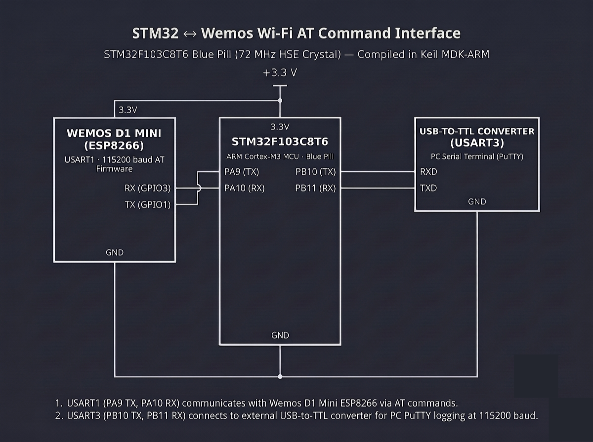

# Continuous Lab Evaluation-11A

**EXP:** Continuous Lab Evaluation-11A  
**DATE:** 12/10/2026  
**NAME OF EXP:** HTTP Server - STM32–Wemos Wi-Fi Modem Using AT Commands — Configure ESP8266 as a TCP Server & Serve Static/Dynamic HTTP Responses  
**HARDWARE SETUP / PLATFORM:** STM32CubeMX + Keil MDK-ARM + STM32F103C8T6 Blue Pill (72 MHz HSE Crystal) + Wemos D1 Mini (ESP8266 AT Firmware on `USART1`: `PA9 TX`, `PA10 RX`) + USB-to-TTL Converter (`USART3`: `PB10 TX`, `PB11 RX`) + PC Serial Terminal (PuTTY) & Web Browser (`115200-8-N-1`)  
**TASK NO:** 11A  

---

### Circuit Diagram


---

### Core Logic

* **1. Dual-UART & Idle-Timeout AT Command Dispatcher (`send_cmds`)**
  Initializes `USART1` (`PA9` TX, `PA10` RX) for ESP8266 AT command exchange and `USART3` (`PB10` TX, `PB11` RX) for PC PuTTY logging at `115200-8-N-1`. `send_cmds()` transmits each AT command over `USART1` and streams incoming modem replies to `USART3` until either `total_wait_time` expires or a `50 ms` inter-byte idle gap (`idle_time = 50`) confirms response completion.
  ```c
  void send_cmds(char *cmd, uint32_t total_wait_time) {
      char send[100];
      snprintf(send, sizeof(send), "\r\n : %s", cmd);

      HAL_UART_Transmit(&huart3, (uint8_t *)send, strlen(send), HAL_MAX_DELAY);
      HAL_UART_Transmit(&huart1, (uint8_t *)cmd, strlen(cmd), HAL_MAX_DELAY);

      uint8_t rx_byte;
      uint32_t overall_start = HAL_GetTick();
      uint32_t last_byte_time = HAL_GetTick();
      const uint32_t idle_time = 50;

      while ((HAL_GetTick() - overall_start) < total_wait_time) {
          if (HAL_UART_Receive(&huart1, &rx_byte, 1, 10) == HAL_OK) {
              HAL_UART_Transmit(&huart3, &rx_byte, 1, HAL_MAX_DELAY);
              last_byte_time = HAL_GetTick();
          } else if ((HAL_GetTick() - last_byte_time) > idle_time) {
              break;
          }
      }
  }
  ```

* **2. Wi-Fi Station Association & Port 80 TCP Server Setup (`wifi_connection`)**
  Verifies modem responsiveness (`AT`), sets Station mode (`AT+CWMODE=1`), joins the local Wi-Fi network (`AT+CWJAP="SNUC", "snu12345"`), retrieves the assigned IPv4 address (`AT+CIFSR`), enables multiple simultaneous client sockets (`AT+CIPMUX=1`), and opens a listening TCP server on port `80` (`AT+CIPSERVER=1,80`).
  ```c
  void wifi_connection(void) {
      HAL_Delay(2000);
      send_cmds("AT\r\n", 1000);
      send_cmds("AT+CWMODE=1\r\n", 1000);
      send_cmds("AT+CWJAP=\"SNUC\", \"snu12345\"\r\n", 12000);
      send_cmds("AT+CIFSR\r\n", 3000);
      send_cmds("AT+CIPMUX=1\r\n", 1000);
      send_cmds("AT+CIPSERVER=1,80\r\n", 3000);
  }
  ```

* **3. `+IPD` HTTP Request Parsing & Two-Step `AT+CIPSEND` HTML Response (`http_server_connection_dynamic`)**
  Listens on `USART1` for incoming browser `GET` frames prefixed with `+IPD,`, extracts the client `link_id` via `sscanf(ipd_ptr, "+IPD,%d,", &link_id)`, computes live system uptime (`HAL_GetTick() / 1000`), formats a complete `HTTP/1.1 200 OK` response with `Content-Type: text/html`, accurate `Content-Length`, and auto-refresh HTML body, dispatches `AT+CIPSEND=<link_id>,<total_len>` followed by the payload, and closes the socket (`AT+CIPCLOSE=<link_id>`).
  ```c
  char *ipd_ptr = strstr(rx_data, "+IPD,");
  if (ipd_ptr != NULL) {
      int link_id = 0;
      sscanf(ipd_ptr, "+IPD,%d,", &link_id);

      int uptime_seconds = HAL_GetTick() / 1000;
      char html_body[256];
      int len = snprintf(html_body, sizeof(html_body),
          "<html><head><meta http-equiv=\"refresh\" content=\"2\"></head>"
          "<body><h1>STM32 & ESP8266 Web Server</h1>"
          "<p><b>Status:</b> Static & Dynamic Data Working!</p>"
          "<p><b>System Uptime:</b> %d seconds</p></body></html>", uptime_seconds);

      char http_response[512];
      int total_len = snprintf(http_response, sizeof(http_response),
          "HTTP/1.1 200 OK\r\nContent-Type: text/html\r\nContent-Length: %d\r\n\r\n%s",
          len, html_body);

      char send_cmd[30];
      snprintf(send_cmd, sizeof(send_cmd), "AT+CIPSEND=%d,%d\r\n", link_id, total_len);
      HAL_UART_Transmit(&huart1, (uint8_t*)send_cmd, strlen(send_cmd), HAL_MAX_DELAY);
      HAL_Delay(50);

      HAL_UART_Transmit(&huart1, (uint8_t*)http_response, total_len, HAL_MAX_DELAY);
      HAL_Delay(50);

      char close_cmd[30];
      snprintf(close_cmd, sizeof(close_cmd), "AT+CIPCLOSE=%d\r\n", link_id);
      HAL_UART_Transmit(&huart1, (uint8_t*)close_cmd, strlen(close_cmd), HAL_MAX_DELAY);
  }
  ```

---

### Inference
Enabling multi-connection TCP server mode (`AT+CIPMUX=1`, `AT+CIPSERVER=1,80`) on the Wemos D1 Mini (ESP8266) allowed the STM32F103C8T6 Blue Pill to operate as an embedded HTTP server accessible over the local Wi-Fi network. Parsing incoming `+IPD` frames to extract the active socket ID and executing the two-step `AT+CIPSEND` sequence with exact `Content-Length` headers reliably served both static HTML markup and real-time `HAL_GetTick()` uptime telemetry directly to a web browser.