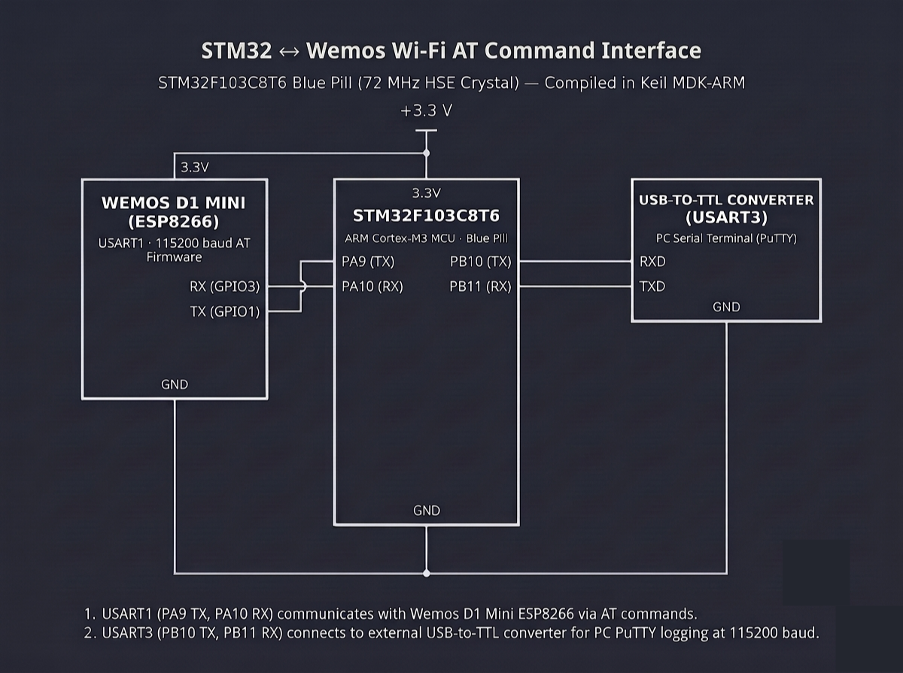

# Continuous Lab Evaluation-11B

**EXP:** Continuous Lab Evaluation-11B  
**DATE:** 10/10/2026  
**NAME OF EXP:** HTTP Server - STM32–Wemos Wi-Fi Modem Using AT Commands — Node-RED HTTP Client Flow & Dynamic Telemetry Integration  
**HARDWARE SETUP / PLATFORM:** STM32CubeMX + Keil MDK-ARM + STM32F103C8T6 Blue Pill (72 MHz HSE Crystal) + Wemos D1 Mini (ESP8266 AT Firmware on `USART1`: `PA9 TX`, `PA10 RX`) + USB-to-TTL Converter (`USART3`: `PB10 TX`, `PB11 RX`) + Node-RED Flow (`Inject → HTTP Request → Debug`)  
**TASK NO:** 11B  

---

### Circuit Diagram


---

### Core Logic

* **1. Wi-Fi Station & Port 80 TCP Listener Initialization (`wifi_connection`)**
  Initializes `USART1` (`PA9` TX, `PA10` RX) and `USART3` (`PB10` TX, `PB11` RX) at `115200-8-N-1`, joins the local Wi-Fi network (`AT+CWMODE=1`, `AT+CWJAP="SNUC", "snu12345"`), logs the ESP8266's assigned IPv4 address (`AT+CIFSR`) to PuTTY over `USART3`, enables multi-socket mode (`AT+CIPMUX=1`), and opens a listening HTTP server on port `80` (`AT+CIPSERVER=1,80`).
  ```c
  void wifi_connection(void) {
      HAL_Delay(2000);
      send_cmds("AT\r\n", 1000);
      send_cmds("AT+CWMODE=1\r\n", 1000);
      send_cmds("AT+CWJAP=\"SNUC\", \"snu12345\"\r\n", 12000);
      send_cmds("AT+CIFSR\r\n", 3000);
      send_cmds("AT+CIPMUX=1\r\n", 1000);
      send_cmds("AT+CIPSERVER=1,80\r\n", 3000);
  }
  ```

* **2. Dynamic `+IPD` HTTP Request Handler (`http_server_connection_dynamic`)**
  Listens on `USART1` for incoming `+IPD,<link_id>,` HTTP `GET` packets triggered by the Node-RED client, extracts the active `link_id`, computes live system uptime (`HAL_GetTick() / 1000`), formats a valid `HTTP/1.1 200 OK` payload (`Content-Type: text/html`, dynamic `Content-Length`), and dispatches the response via the two-step `AT+CIPSEND=<link_id>,<total_len>` handshake before closing the socket (`AT+CIPCLOSE=<link_id>`).
  ```c
  char *ipd_ptr = strstr(rx_data, "+IPD,");
  if (ipd_ptr != NULL) {
      int link_id = 0;
      sscanf(ipd_ptr, "+IPD,%d,", &link_id);

      int uptime_seconds = HAL_GetTick() / 1000;
      char html_body[256];
      int len = snprintf(html_body, sizeof(html_body),
          "<html><head><meta http-equiv=\"refresh\" content=\"2\"></head>"
          "<body><h1>STM32 & ESP8266 Web Server</h1>"
          "<p><b>Status:</b> Static & Dynamic Data Working!</p>"
          "<p><b>System Uptime:</b> %d seconds</p></body></html>", uptime_seconds);

      char http_response[512];
      int total_len = snprintf(http_response, sizeof(http_response),
          "HTTP/1.1 200 OK\r\nContent-Type: text/html\r\nContent-Length: %d\r\n\r\n%s",
          len, html_body);

      char send_cmd[30];
      snprintf(send_cmd, sizeof(send_cmd), "AT+CIPSEND=%d,%d\r\n", link_id, total_len);
      HAL_UART_Transmit(&huart1, (uint8_t*)send_cmd, strlen(send_cmd), HAL_MAX_DELAY);
      HAL_Delay(50);

      HAL_UART_Transmit(&huart1, (uint8_t*)http_response, total_len, HAL_MAX_DELAY);
      HAL_Delay(50);

      char close_cmd[30];
      snprintf(close_cmd, sizeof(close_cmd), "AT+CIPCLOSE=%d\r\n", link_id);
      HAL_UART_Transmit(&huart1, (uint8_t*)close_cmd, strlen(close_cmd), HAL_MAX_DELAY);
  }
  ```

* **3. Node-RED `Inject → HTTP Request → Debug` Client Pipeline**
  Configures a three-node Node-RED flow on the host PC where an **Inject** node triggers an HTTP `GET` request via an **HTTP Request** node targeting `http://<ESP8266_IP>/` (using the IPv4 address reported by `AT+CIFSR`), routing the returned `HTTP/1.1 200 OK` HTML payload directly into a **Debug** sidebar node for automated telemetry verification.
  ```text
  [ Inject (Timestamp) ] ---> [ HTTP Request (GET http://<ESP8266_IP>/) ] ---> [ Debug (msg.payload) ]
  ```

---

### Inference
Connecting the Node-RED `Inject → HTTP Request → Debug` flow to `http://<ESP8266_IP>/` over the local Wi-Fi network successfully automated HTTP `GET` polling against the STM32F103C8T6 + Wemos D1 Mini server. Each trigger in Node-RED generated an `+IPD` socket frame on `USART1`, prompting the STM32 to return a well-formed `HTTP/1.1 200 OK` response containing updated system uptime telemetry directly in the Node-RED Debug console.