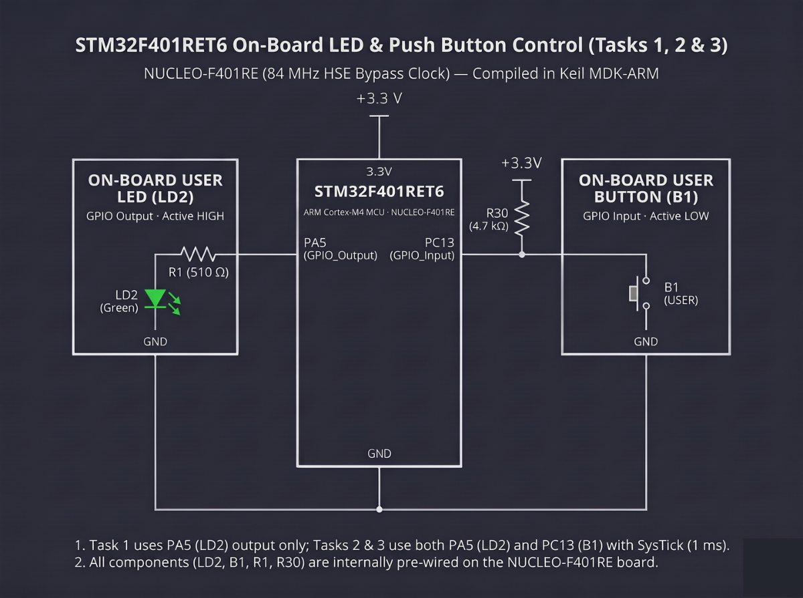

# Continuous Lab Evaluation-12A

**EXP:** Continuous Lab Evaluation-12A  
**DATE:** 26/10/2026  
**NAME OF EXP:** STM32F401RE Cortex-M4: GPIO and User Input Programming — On-board User LED (LD2) Bring-Up  
**HARDWARE SETUP / PLATFORM:** STM32CubeMX + Keil MDK-ARM + STMicroelectronics NUCLEO-F401RE (STM32F401RET6 Cortex-M4, 84 MHz HSE Bypass Clock) + On-board ST-LINK/V2-1 + Green User LED (`LD2` on `PA5`)  
**TASK NO:** 12A  

---

### Circuit Diagram


---

### Core Logic

* **1. On-Board User LED (`PA5`) Push-Pull Output Initialization (`MX_GPIO_Init`)**
  Enables the `GPIOA` peripheral clock (`__HAL_RCC_GPIOA_CLK_ENABLE()`), initializes `PA5` to a known LOW state (`GPIO_PIN_RESET`), and configures `PA5` as a low-speed push-pull output (`GPIO_MODE_OUTPUT_PP`, `GPIO_NOPULL`) to drive the NUCLEO-F401RE's green user LED (`LD2`, active-HIGH through on-board resistor `R1 = 510 Ω`).
  ```c
  __HAL_RCC_GPIOA_CLK_ENABLE();
  HAL_GPIO_WritePin(GPIOA, GPIO_PIN_5, GPIO_PIN_RESET);

  GPIO_InitStruct.Pin = GPIO_PIN_5;
  GPIO_InitStruct.Mode = GPIO_MODE_OUTPUT_PP;
  GPIO_InitStruct.Pull = GPIO_NOPULL;
  GPIO_InitStruct.Speed = GPIO_SPEED_FREQ_LOW;
  HAL_GPIO_Init(GPIOA, &GPIO_InitStruct);
  ```

* **2. Fixed-Interval Hardware Bring-Up Blink Loop (`main`)**
  Calls `HAL_GPIO_TogglePin(GPIOA, GPIO_PIN_5)` followed by a `500 ms` SysTick delay (`HAL_Delay(500)`) inside the `while(1)` super-loop, blinking `LD2` at a deterministic `1 Hz` rate (`500 ms` ON / `500 ms` OFF) to verify board power, clock tree initialization, and GPIO output control.
  ```c
  while (1)
  {
      // Toggle on-board LED PA5 every fixed interval
      HAL_GPIO_TogglePin(GPIOA, GPIO_PIN_5);
      HAL_Delay(500);
  }
  ```

---

### Inference
Configuring `PA5` as a push-pull digital output (`GPIO_MODE_OUTPUT_PP`) via STM32CubeMX and HAL on the NUCLEO-F401RE (STM32F401RET6 Cortex-M4) successfully verified board bring-up in Keil MDK-ARM. Toggling `PA5` every `500 ms` with `HAL_GPIO_TogglePin()` and `HAL_Delay(500)` produced a steady, symmetric `1 Hz` blink on the on-board green user LED (`LD2`), confirming proper SysTick timing and GPIO peripheral operation.