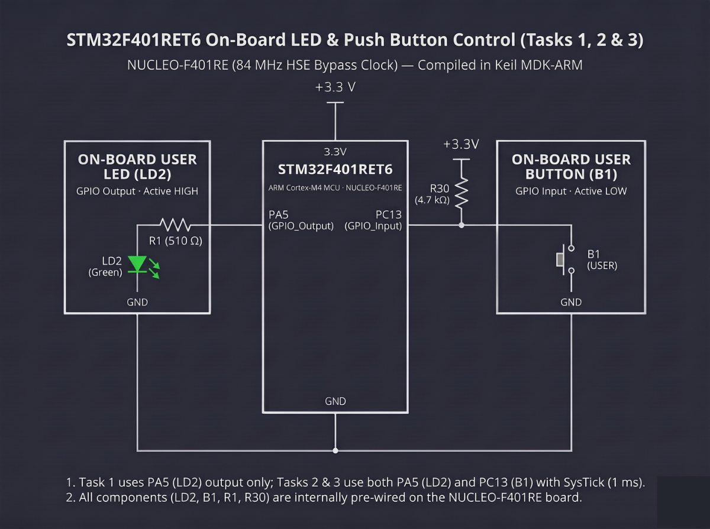

# Continuous Lab Evaluation-12B

**EXP:** Continuous Lab Evaluation-12B  
**DATE:** 26/10/2026  
**NAME OF EXP:** STM32F401RE Cortex-M4: GPIO and User Input Programming — On-board Switch Control with State Remembrance  
**HARDWARE SETUP / PLATFORM:** STM32CubeMX + Keil MDK-ARM + STMicroelectronics NUCLEO-F401RE (STM32F401RET6 Cortex-M4, 84 MHz HSE Bypass Clock) + On-board ST-LINK/V2-1 + Green User LED (`LD2` on `PA5`) + Blue User Push Button (`B1` on `PC13`, Active-LOW with external `4.7 kΩ` pull-up)  
**TASK NO:** 12B  

---

### Circuit Diagram


---

### Core Logic

* **1. On-Board User Button (`PC13`) & User LED (`PA5`) GPIO Configuration (`MX_GPIO_Init`)**
  Enables both `GPIOC` and `GPIOA` peripheral clocks (`__HAL_RCC_GPIOC_CLK_ENABLE()`, `__HAL_RCC_GPIOA_CLK_ENABLE()`), configures `PC13` as a digital input (`GPIO_MODE_INPUT`, `GPIO_NOPULL` since `R30 = 4.7 kΩ` pulls the line to `+3.3 V` on the NUCLEO-F401RE board), and configures `PA5` as a push-pull output (`GPIO_MODE_OUTPUT_PP`) initialized LOW (`GPIO_PIN_RESET`) for `LD2`.
  ```c
  __HAL_RCC_GPIOC_CLK_ENABLE();
  __HAL_RCC_GPIOA_CLK_ENABLE();
  HAL_GPIO_WritePin(GPIOA, GPIO_PIN_5, GPIO_PIN_RESET);

  GPIO_InitStruct.Pin = GPIO_PIN_13;
  GPIO_InitStruct.Mode = GPIO_MODE_INPUT;
  GPIO_InitStruct.Pull = GPIO_NOPULL;
  HAL_GPIO_Init(GPIOC, &GPIO_InitStruct);

  GPIO_InitStruct.Pin = GPIO_PIN_5;
  GPIO_InitStruct.Mode = GPIO_MODE_OUTPUT_PP;
  GPIO_InitStruct.Pull = GPIO_NOPULL;
  GPIO_InitStruct.Speed = GPIO_SPEED_FREQ_LOW;
  HAL_GPIO_Init(GPIOA, &GPIO_InitStruct);
  ```

* **2. Debounced Edge Detection, Toggle & Release-Lock Loop (`main`)**
  Polls `PC13` (`HAL_GPIO_ReadPin(GPIOC, GPIO_PIN_13) == GPIO_PIN_RESET`) for an active-low press on button `B1`, applies a `50 ms` software debounce delay (`HAL_Delay(50)`), re-verifies the logic LOW level before calling `HAL_GPIO_TogglePin(GPIOA, GPIO_PIN_5)`, and holds in a release-wait loop (`while (HAL_GPIO_ReadPin(GPIOC, GPIO_PIN_13) == GPIO_PIN_RESET)`) so `LD2` latches its new state cleanly after `B1` is released.
  ```c
  while (1)
  {
      // Detect active-LOW button press on PC13
      if (HAL_GPIO_ReadPin(GPIOC, GPIO_PIN_13) == GPIO_PIN_RESET)
      {
          HAL_Delay(50);

          if (HAL_GPIO_ReadPin(GPIOC, GPIO_PIN_13) == GPIO_PIN_RESET)
          {
              HAL_GPIO_TogglePin(GPIOA, GPIO_PIN_5);
              while (HAL_GPIO_ReadPin(GPIOC, GPIO_PIN_13) == GPIO_PIN_RESET)
              {
              }
          }
      }
  }
  ```

---

### Inference
Reading the NUCLEO-F401RE's on-board active-low user button (`B1` on `PC13`) with a `50 ms` software debounce window and a release-lock loop allowed each physical button press to toggle `LD2` (`PA5`) once and retain its latched state after release. This prevented contact bounce from causing erratic double-toggles while demonstrating deterministic state remembrance on the STM32F401RET6 Cortex-M4 platform.