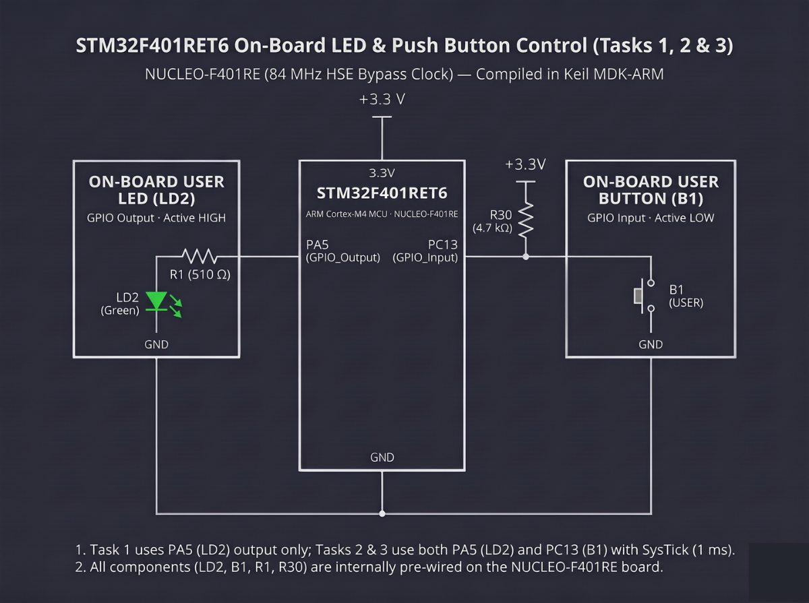

# Continuous Lab Evaluation-12C

**EXP:** Continuous Lab Evaluation-12C  
**DATE:** 26/10/2026  
**NAME OF EXP:** STM32F401RE Cortex-M4: GPIO and User Input Programming — Short-Press and Long-Press Detection  
**HARDWARE SETUP / PLATFORM:** STM32CubeMX + Keil MDK-ARM + STMicroelectronics NUCLEO-F401RE (STM32F401RET6 Cortex-M4, 84 MHz HSE Bypass Clock) + On-board ST-LINK/V2-1 + Green User LED (`LD2` on `PA5`) + Blue User Push Button (`B1` on `PC13`, Active-LOW with external `4.7 kΩ` pull-up)  
**TASK NO:** 12C  

---

### Circuit Diagram


---

### Core Logic

* **1. On-Board GPIO Configuration & Non-Blocking Mode State Variables (`MX_GPIO_Init`, `main`)**
  Enables `GPIOC` (`PC13` as digital input for active-low user button `B1`) and `GPIOA` (`PA5` as push-pull output initialized LOW for green user LED `LD2`), and declares `blinking_mode` (`0` = Static Toggle Mode, `1` = Continuous Blinking Mode) alongside `last_blink_time` for `1 ms` SysTick timing.
  ```c
  uint8_t blinking_mode = 0;
  uint32_t last_blink_time = 0;
  ```

* **2. SysTick Press-Duration Measurement & Short/Long Press Classification (`HAL_GetTick`)**
  After a `50 ms` press debounce delay on `PC13`, captures `press_start = HAL_GetTick()` and monitors the hold interval until `B1` is released. A **Long Press** (`press_duration >= 1000 ms`) enables continuous blinking (`blinking_mode = 1`), whereas a **Short Press** (`< 1000 ms`) exits blinking mode if active or toggles the static state of `LD2` (`HAL_GPIO_TogglePin(GPIOA, GPIO_PIN_5)`).
  ```c
  uint32_t press_start = HAL_GetTick();

  while (HAL_GPIO_ReadPin(GPIOC, GPIO_PIN_13) == GPIO_PIN_RESET)
  {
      if (blinking_mode && (HAL_GetTick() - last_blink_time >= 200))
      {
          HAL_GPIO_TogglePin(GPIOA, GPIO_PIN_5);
          last_blink_time = HAL_GetTick();
      }
  }

  uint32_t press_duration = HAL_GetTick() - press_start;

  if (press_duration >= 1000)
  {
      blinking_mode = 1;
  }
  else
  {
      if (blinking_mode)
      {
          blinking_mode = 0;
      }
      else
      {
          /* Toggle static LED state */
          HAL_GPIO_TogglePin(GPIOA, GPIO_PIN_5);
      }
  }
  ```

* **3. Non-Blocking `200 ms` Continuous Blinking Loop (`main`)**
  While `blinking_mode` is set, evaluates `HAL_GetTick() - last_blink_time >= 200` on each iteration of the `while(1)` super-loop to toggle `PA5` every `200 ms` without blocking button-press detection.
  ```c
  if (blinking_mode)
  {
      if (HAL_GetTick() - last_blink_time >= 200)
      {
          HAL_GPIO_TogglePin(GPIOA, GPIO_PIN_5);
          last_blink_time = HAL_GetTick();
      }
  }
  ```

---

### Inference
Measuring active-low hold duration on the NUCLEO-F401RE's user button (`B1` on `PC13`) with the `1 ms` SysTick timer (`HAL_GetTick()`) accurately differentiated short presses (`< 1 s`) from long presses (`≥ 1 s`) on the STM32F401RET6 Cortex-M4. Pairing `50 ms` software debouncing with non-blocking `200 ms` SysTick interval checks enabled seamless switching between static `LD2` toggling and continuous blinking without blocking input polling.