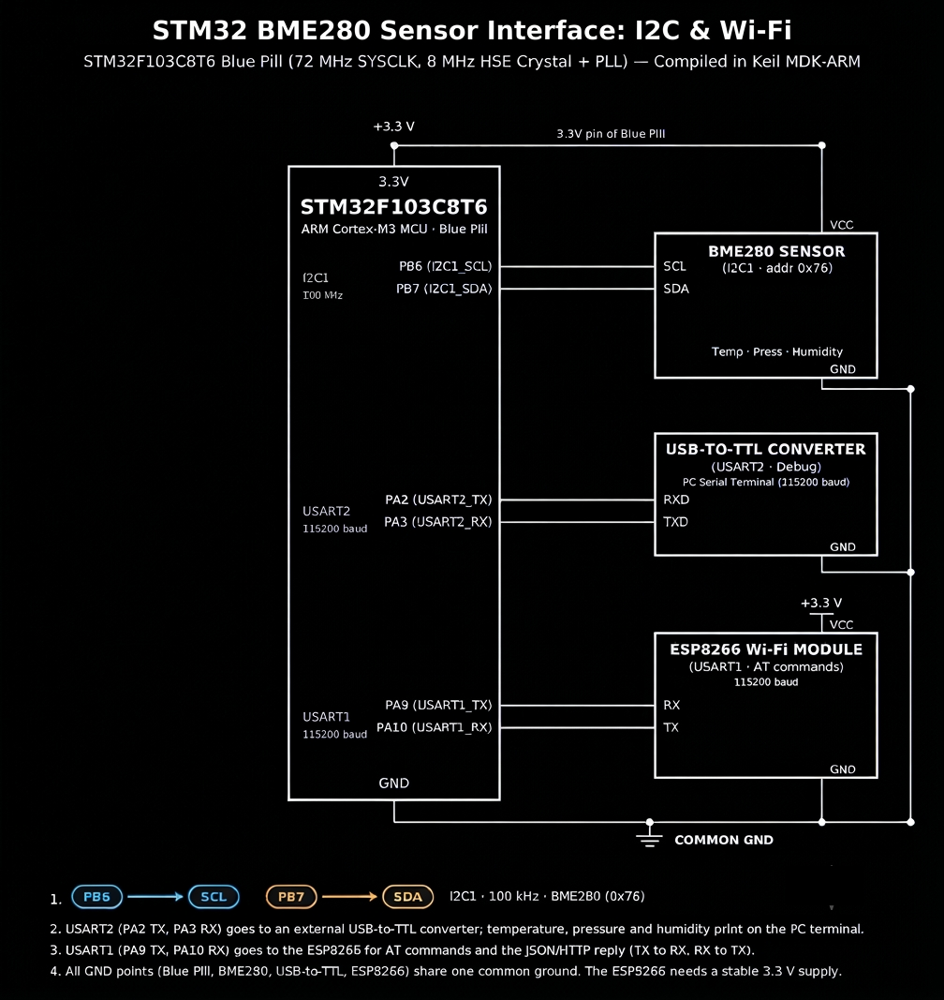

# Continuous Lab Evaluation-13

**EXP:** Continuous Lab Evaluation-13  
**DATE:** 26/10/2026  
**NAME OF EXP:** Sensor Interfacing (BME280) – STM32 (Debug) – ESP8266 (Wi-Fi) HTTP – Node Analytics — BME280 Sensor Interfacing Using I²C and Bosch Sensor API  
**HARDWARE SETUP / PLATFORM:** STM32CubeMX + Keil MDK-ARM + STM32F103C8T6 Blue Pill (72 MHz SYSCLK, 8 MHz HSE Crystal + PLL) + Bosch BME280 Environmental Sensor (`I2C1`: `PB6 SCL`, `PB7 SDA`, `100 kHz`, address `0x76`) + USB-to-TTL Converter (`USART2`: `PA2 TX`, `PA3 RX`, `115200 baud`) + ESP8266 Wi-Fi Module (`USART1`: `PA9 TX`, `PA10 RX`, `115200 baud`)  
**TASK NO:** 13  

---

### Circuit Diagram


---

### Core Logic

* **1. Bosch BME280 HAL I²C Bus & Microsecond Delay Callbacks (`user_i2c_read`, `user_i2c_write`, `user_delay_us`)**
  Bridges the official Bosch Sensortec `BME280_SensorAPI` (`bme280.c`, `bme280.h`, `bme280_defs.h`) to STM32 HAL `I2C1` (`100 kHz`, 7-bit address `0x76` left-shifted via `(dev_addr << 1)`) using `HAL_I2C_Mem_Read()` and `HAL_I2C_Mem_Write()`, while mapping microsecond delays upward to `HAL_Delay()`.
  ```c
  int8_t user_i2c_read(uint8_t reg_addr, uint8_t *reg_data, uint32_t len, void *intf_ptr) {
      uint8_t dev_addr = *(uint8_t*)intf_ptr;
      if (HAL_I2C_Mem_Read(&hi2c1, (dev_addr << 1), reg_addr, I2C_MEMADD_SIZE_8BIT, reg_data, len, HAL_MAX_DELAY) == HAL_OK) {
          return BME280_OK;
      }
      return BME280_E_COMM_FAIL;
  }

  int8_t user_i2c_write(uint8_t reg_addr, const uint8_t *reg_data, uint32_t len, void *intf_ptr) {
      uint8_t dev_addr = *(uint8_t*)intf_ptr;
      if (HAL_I2C_Mem_Write(&hi2c1, (dev_addr << 1), reg_addr, I2C_MEMADD_SIZE_8BIT, (uint8_t*)reg_data, len, HAL_MAX_DELAY) == HAL_OK) {
          return BME280_OK;
      }
      return BME280_E_COMM_FAIL;
  }

  void user_delay_us(uint32_t period, void *intf_ptr) {
      HAL_Delay((period / 1000) + 1);
  }
  ```

* **2. Sensor Calibration, `1×` Oversampling & Normal Mode Initialization (`main`)**
  Binds the `bme280_dev` struct to `BME280_I2C_ADDR_PRIM` (`0x76`), invokes `bme280_init(&dev)` to load factory NVM trimming parameters, configures `1×` oversampling across temperature, pressure, and humidity (`BME280_OVERSAMPLING_1X`) with the IIR filter off, and starts continuous sampling in `BME280_POWERMODE_NORMAL`.
  ```c
  static uint8_t dev_addr = BME280_I2C_ADDR_PRIM; // 0x76
  dev.intf_ptr = &dev_addr;
  dev.intf = BME280_I2C_INTF;
  dev.read = user_i2c_read;
  dev.write = user_i2c_write;
  dev.delay_us = user_delay_us;

  rslt = bme280_init(&dev);

  settings.osr_h = BME280_OVERSAMPLING_1X;
  settings.osr_p = BME280_OVERSAMPLING_1X;
  settings.osr_t = BME280_OVERSAMPLING_1X;
  settings.filter = BME280_FILTER_COEFF_OFF;

  rslt = bme280_set_sensor_settings(BME280_SEL_OSR_PRESS | BME280_SEL_OSR_TEMP |
         BME280_SEL_OSR_HUM | BME280_SEL_FILTER | BME280_SEL_STANDBY, &settings, &dev);
  rslt = bme280_set_sensor_mode(BME280_POWERMODE_NORMAL, &dev);
  ```

* **3. Compensated Telemetry Acquisition, `USART2` Debug Logging & `USART1` JSON/HTTP Transmission (`main`)**
  Reads compensated environmental readings every `1000 ms` via `bme280_get_sensor_data(BME280_ALL, &comp_data, &dev)`, converts pressure from `Pa` to `hPa` (`comp_data.pressure / 100.0f`), prints formatted readings to the PC serial terminal over `USART2` (`PA2` TX), builds a dynamic JSON payload (`{"status":"success","temperature":...,"humidity":...,"pressure":...}`), wraps it inside an `HTTP/1.1 200 OK` response (`Content-Type: application/json`), and transmits it to the ESP8266 Wi-Fi module over `USART1` (`PA9` TX) using `AT+CIPSEND=0,<response_length>`.
  ```c
  rslt = bme280_get_sensor_data(BME280_ALL, &comp_data, &dev);

  if (rslt == BME280_OK) {
      temperature = comp_data.temperature;
      pressure = comp_data.pressure / 100.0f;
      humidity = comp_data.humidity;

      char buf[100];
      int n = snprintf(buf, sizeof(buf),
                   "Temp: %.2f C | Press: %.2f hPa | Hum: %.2f %%RH\r\n",
                   temperature, pressure, humidity);
      HAL_UART_Transmit(&huart2, (uint8_t*)buf, n, HAL_MAX_DELAY);

      char json_payload[200];
      snprintf(json_payload, sizeof(json_payload),
            "{\"status\":\"success\",\"temperature\":%.2f,\"humidity\":%.2f,\"pressure\":%.2f}",
            temperature, humidity, pressure);

      char http_response[350];
      snprintf(http_response, sizeof(http_response),
            "HTTP/1.1 200 OK\r\n"
            "Content-Type: application/json\r\n"
            "Content-Length: %d\r\n\r\n%s",
            (int)strlen(json_payload), json_payload);

      int response_length = strlen(http_response);
      char at_cmd[50];
      snprintf(at_cmd, sizeof(at_cmd), "AT+CIPSEND=0,%d\r\n", response_length);
      HAL_UART_Transmit(&huart1, (uint8_t*)at_cmd, strlen(at_cmd), HAL_MAX_DELAY);
      HAL_Delay(100);
      HAL_UART_Transmit(&huart1, (uint8_t*)http_response, response_length, HAL_MAX_DELAY);
  }
  ```

---

### Inference
Integrating the official Bosch Sensortec BME280 Sensor API over `I2C1` (`PB6` SCL / `PB7` SDA at `100 kHz`, address `0x76`) on the STM32F103C8T6 Blue Pill enabled accurate, factory-compensated temperature (`°C`), barometric pressure (`hPa`), and relative humidity (`%RH`) measurements. Simultaneously streaming human-readable diagnostics to the PC terminal via `USART2` while packaging live readings into dynamic `HTTP/1.1 200 OK` JSON payloads over `USART1` to the ESP8266 established a complete end-to-end IoT environmental sensing pipeline.