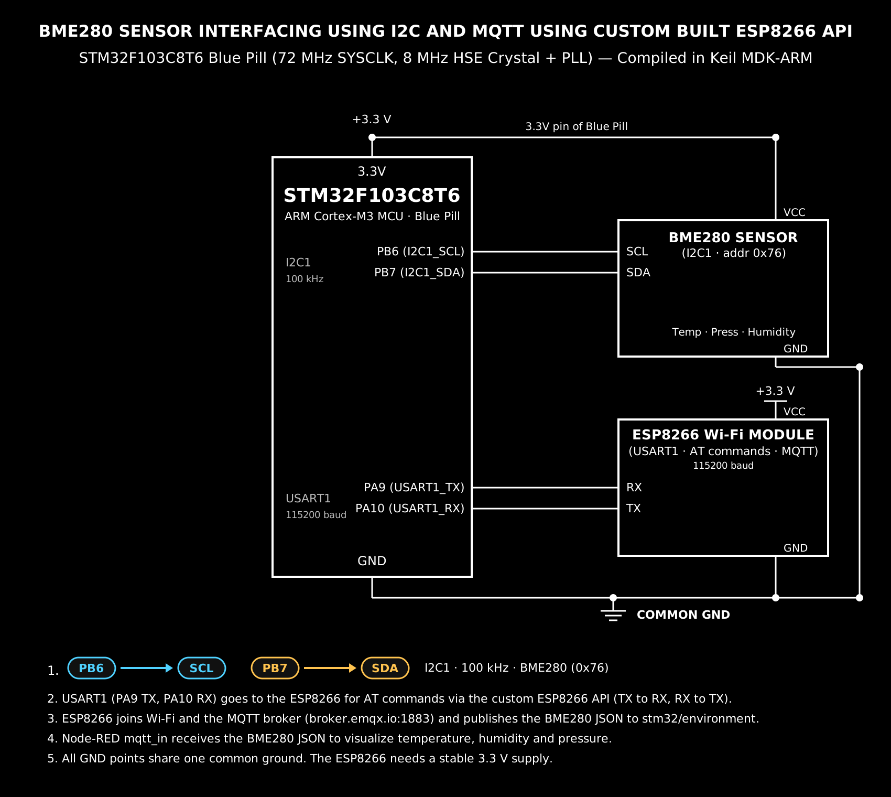

# Continuous Lab Evaluation-14

**EXP:** Continuous Lab Evaluation-14  
**DATE:** 27/10/2026  
**NAME OF EXP:** Sensor Interfacing (BME280) – (MQTT) – Node Analytics — BME280 Sensor Interfacing Using I²C and MQTT Using Custom-Built ESP8266 API  
**HARDWARE SETUP / PLATFORM:** STM32CubeMX + Keil MDK-ARM + STM32F103C8T6 Blue Pill (72 MHz SYSCLK, 8 MHz HSE Crystal + PLL) + Bosch BME280 Environmental Sensor (`I2C1`: `PB6 SCL`, `PB7 SDA`, `100 kHz`, address `0x76`) + ESP8266 Wi-Fi Module (`USART1`: `PA9 TX`, `PA10 RX`, `115200 baud`) + PC Debug Terminal (`USART2`, `115200 baud`) + Public MQTT Broker (`broker.emqx.io:1883`) & Node-RED (`mqtt_in` Node)  
**TASK NO:** 14  

---

### Circuit Diagram


---

### Core Logic

* **1. Bosch BME280 I²C Driver Bridge & High-Precision Oversampling Setup (`Setup_Hardware_Sensors`)**
  Links the Bosch Sensortec `BME280_SensorAPI` (`bme280.c`, `bme280.h`) to `I2C1` (`100 kHz`, shifted address `0x76 << 1 = 0xEC`) via `user_i2c_read()`, `user_i2c_write()`, and `user_delay_us()`, then configures `1×` humidity, `16×` pressure, and `2×` temperature oversampling with IIR filter coefficient `16` and `62.5 ms` standby in `BME280_POWERMODE_NORMAL`.
  ```c
  void Setup_Hardware_Sensors(void) {
      bme280.intf_ptr = &bme_i2c_addr;
      bme280.intf     = BME280_I2C_INTF;
      bme280.read     = user_i2c_read;
      bme280.write    = user_i2c_write;
      bme280.delay_us = user_delay_us;

      bme280_init(&bme280);

      settings.osr_h        = BME280_OVERSAMPLING_1X;
      settings.osr_p        = BME280_OVERSAMPLING_16X;
      settings.osr_t        = BME280_OVERSAMPLING_2X;
      settings.filter       = BME280_FILTER_COEFF_16;
      settings.standby_time = BME280_STANDBY_TIME_62_5_MS;

      uint8_t settings_sel = BME280_SEL_OSR_PRESS | BME280_SEL_OSR_TEMP |
                             BME280_SEL_OSR_HUM | BME280_SEL_FILTER | BME280_SEL_STANDBY;
      bme280_set_sensor_settings(settings_sel, &settings, &bme280);
      bme280_set_sensor_mode(BME280_POWERMODE_NORMAL, &bme280);
  }
  ```

* **2. Custom `ESPLib` Wi-Fi Station Association, TCP Socket & MQTT Broker Handshake (`main`)**
  Uses the custom `ESPLib` driver (`ESPLib.c`, `ESPLib.h`) over `USART1` (`115200 baud`) to set Station mode (`ESP8266_Init(1, huart1)`), join the Wi-Fi network (`ESP8266_wifiConnect("SNUC", "snu12345")`), open a TCP socket to `broker.emqx.io` on port `1883` (`ESP8266_portConnect`), transmit a raw binary MQTT `CONNECT` control packet (`MQTT_connectBroker`), and subscribe to `stm32/control` (`MQTT_subscribeTopic`).
  ```c
  ESP8266_Init(1, huart1);
  ESP8266_wifiConnect((char*)WIFI_SSID, (char*)WIFI_PASS);
  ESP8266_portConnect("TCP", (char*)MQTT_BROKER, (char*)MQTT_PORT);

  MQTT_InitTypeDef_t mqttInitConfig;
  mqttInitConfig.clientID    = "STM32_BME280_Node_SNUC_01";
  mqttInitConfig.keepAlive   = 500;
  mqttInitConfig.connectFlag = CleanSession;

  MQTT_connectBroker(&mqttInitConfig);
  MQTT_subscribeTopic("stm32/control", 0);
  ```

* **3. Periodic JSON Telemetry Publishing & Bidirectional MQTT Control Loop (`main`)**
  Every `5000 ms` (`HAL_GetTick()`), acquires compensated temperature (`°C`), humidity (`%RH`), and pressure (`hPa`) from the BME280, formats the JSON string (`{"status":"success","temperature":...,"humidity":...,"pressure":...}`), and publishes it to `stm32/environment` via `MQTT_publishTopic()` for Node-RED `mqtt_in` analytics, while continuously polling `MQTTDataHandler()` to toggle the Blue Pill's active-low LED (`PC13`) on incoming `"ON"`/`"OFF"` messages from `stm32/control`.
  ```c
  if ((HAL_GetTick() - lastPubTime) > 5000) {
      lastPubTime = HAL_GetTick();
      struct bme280_data comp_data;
      bme280_get_sensor_data(BME280_ALL, &comp_data, &bme280);

      char payload[128];
      snprintf(payload, sizeof(payload),
          "{\"status\":\"success\",\"temperature\":%.2f,\"humidity\":%.2f,\"pressure\":%.2f}",
          comp_data.temperature, comp_data.humidity, comp_data.pressure / 100.0);

      MQTT_publishTopic("stm32/environment", payload, 0);
  }

  MQTTDataHandler(rxTopic, rxMsg);
  if (strlen(rxMsg) > 0) {
      if (strstr(rxMsg, "ON") != NULL) {
          HAL_GPIO_WritePin(GPIOC, GPIO_PIN_13, GPIO_PIN_RESET);
      } else if (strstr(rxMsg, "OFF") != NULL) {
          HAL_GPIO_WritePin(GPIOC, GPIO_PIN_13, GPIO_PIN_SET);
      }
      memset(rxMsg, 0, sizeof(rxMsg));
      memset(rxTopic, 0, sizeof(rxTopic));
  }
  ```

---

### Inference
Combining the Bosch Sensortec BME280 I²C driver (`PB6` SCL / `PB7` SDA at `100 kHz`, address `0x76`) with the custom-built `ESPLib` MQTT protocol stack over `USART1` (`115200 baud`) enabled the STM32F103C8T6 Blue Pill to stream structured JSON environmental telemetry directly to `broker.emqx.io:1883` on topic `stm32/environment`. Subscribing a Node-RED `mqtt_in` node to `stm32/environment` decoded the live temperature, humidity, and pressure readings for dashboard visualization, while simultaneous subscription to `stm32/control` demonstrated bidirectional cloud-to-edge actuation on `PC13`.