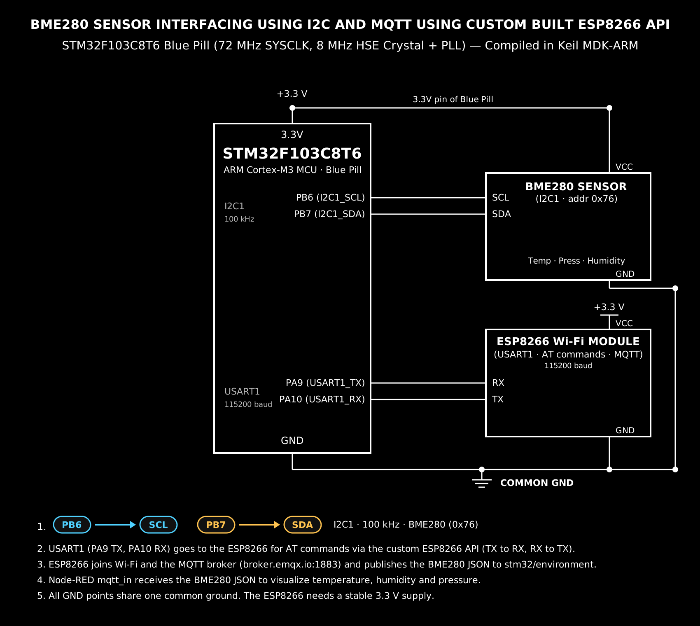
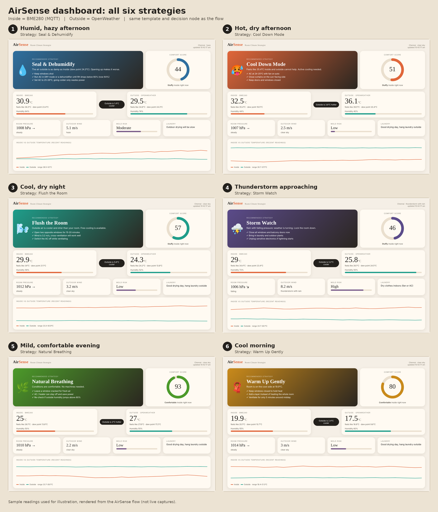

# AirSense — Indoor–Outdoor Psychrometric Room Climate Strategist

**EXP:** Continuous Lab Evaluation-15 (Project)  
**DATE:** 12/11/2026  
**NAME OF EXP:** AirSense: Indoor–Outdoor Psychrometric Room Climate Strategist Using STM32F401RE, Bosch BME280, Wemos D1 Mini (ESP8266) MQTT Bridge & Node-RED Analytics Dashboard  
**TASK NO:** 15  

---

## Overview

**AirSense** is an end-to-end edge-to-cloud IoT environmental intelligence system that compares live indoor room conditions against real-time outdoor meteorological telemetry to recommend actionable HVAC, ventilation, and storm-readiness strategies.

Rather than relying on static single-sensor temperature thresholds, AirSense computes **Magnus–Tetens dew points**, **apparent ("feels-like") temperatures**, and **barometric pressure trends** across both indoor and outdoor environments to decide whether passive cross-ventilation ("free cooling"), dehumidification, active cooling, or window sealing is the most effective and energy-efficient action.

---

## System Architecture

```text
+-----------------------------------+      +------------------------------------+
|        INDOOR EDGE NODE           |      |       UART-TO-MQTT GATEWAY         |
|  STM32F401RET6 (NUCLEO-F401RE)    |      |     Wemos D1 Mini (ESP8266)        |
|  - 84 MHz SYSCLK (PLL)            |      |  - SoftwareSerial RX (9600 baud)   |
|  - Bosch BME280 Sensor (I2C1)     |----->|  - Strict CSV Bounds Validation    |
|  - Compensated T, P, H @ 1 Hz     | UART |  - JSON Serialization & PubSub     |
+-----------------------------------+      +-----------------+------------------+
                                                             |
                                                             | MQTT Publish (QoS 0)
                                                             | test.mosquitto.org:1883
                                                             v
+-----------------------------------+      +------------------------------------+
|      OUTDOOR WEATHER FEED         |      |      NODE-RED ANALYTICS ENGINE     |
|     OpenWeatherMap REST API       |      |  - mqtt_in + HTTP Request Fusion   |
|  - Polled every 10 min (600 s)    |----->|  - Dew Point & Feels-Like Math     |
|  - Temp, RH, Wind, Weather State  | HTTP |  - 40-Sample Pressure Trend Buffer |
+-----------------------------------+      |  - 6-Strategy Psychrometric Engine |
                                           +-----------------+------------------+
                                                             |
                                                             v
                                           +------------------------------------+
                                           |    CUSTOM NODE-RED UI DASHBOARD    |
                                           |  - Dynamic Strategy Hero Card      |
                                           |  - SVG Comfort Score Gauge (0-100) |
                                           |  - Indoor vs Outdoor Delta Cards   |
                                           |  - Mold Risk & Laundry Advisories  |
                                           |  - 40-Point Dual SVG Sparkline     |
                                           +------------------------------------+
```

---

## Hardware & Software Stack

* **Edge Microcontroller:** STMicroelectronics NUCLEO-F401RE (`STM32F401RET6` ARM Cortex-M4, `84 MHz` SYSCLK via PLL, CubeMX `FW_F4 V1.28.3`, compiled in Keil MDK-ARM V5.32)
* **Environmental Sensor:** Bosch Sensortec `BME280` (`I2C1` at `100 kHz`, 7-bit address `0x76`) running the official `BME280_SensorAPI` (`v3.5.1`)
* **Wi-Fi / MQTT Gateway:** Wemos D1 Mini (`ESP8266`) programmed with `ESP8266WiFi`, `PubSubClient`, and `SoftwareSerial`
* **MQTT Broker:** Public Mosquitto Broker (`test.mosquitto.org:1883`)
* **External Weather API:** OpenWeatherMap Current Weather REST API (`metric` units)
* **Analytics & Visualization:** Node-RED with `node-red-dashboard` (`v3.6.6`) and custom Angular/SVG `ui_template`

---

## Circuit Diagram & Dashboard Preview

### Hardware Interfacing Diagram


### AirSense Dashboard (All Six Climate Strategies)


---

## Repository Structure

```text
AirSense-Project/
├── STM32_Firmware/
│   ├── Core/
│   │   ├── Inc/
│   │   │   ├── main.h
│   │   │   ├── bme280.h
│   │   │   └── bme280_defs.h
│   │   └── Src/
│   │       ├── main.c                  # Clock config, I2C1/UART init & 1 Hz telemetry loop
│   │       └── bme280.c                # Bosch Sensortec BME280 compensation driver
│   └── NUCLEO_BME280_test.ioc          # STM32CubeMX peripheral & clock configuration
├── ESP8266_Gateway/
│   └── Wemos_BME280_MQTT.ino           # UART parser, validation filter & MQTT publisher
├── NodeRED_Flow/
│   └── flows.json                      # Complete Node-RED flow, decision logic & UI template
├── Docs/
│   ├── FINAL_CAT14.png                 # Hardware block & interfacing diagram
│   └── Airsense_dashboard.png          # Rendered dashboard states across all 6 strategies
└── README.md
```

---

## Firmware & Pipeline Breakdown

### 1. STM32F401RE Sensor Acquisition (`main.c` & `bme280.c`)

* **Clock & Peripherals:** Configured in `NUCLEO_BME280_test.ioc` with `SYSCLK = 84 MHz` (`APB1 = 42 MHz`, `APB2 = 84 MHz`), `I2C1` in Standard Mode (`100 kHz`), `USART1` at `9600 baud` (gateway link), and `USART2` at `115200 baud` (ST-LINK debug VCP).
* **Driver Integration:** Bridges `bme280_dev` read/write pointers to `HAL_I2C_Mem_Read()` and `HAL_I2C_Mem_Write()` using left-shifted 7-bit address `0x76 << 1`, verifies device presence via `HAL_I2C_IsDeviceReady()`, loads factory NVM trimming registers during `bme280_init()`, and runs continuous sampling in `BME280_POWERMODE_NORMAL` (`1×` oversampling across T/P/H, `1000 ms` standby).
* **Telemetry Output:** Every `1000 ms`, compensated readings are converted (`pressure = comp_data.pressure / 100.0f` for `hPa`) and formatted into compact CSV frames transmitted simultaneously to the ESP8266 and the host PC terminal:
  ```c
  int count = snprintf(mqttData, sizeof(mqttData),
                       "%.2f,%.2f,%.2f\n",
                       temperature, pressure, humidity);

  if (count > 0 && count < (int)sizeof(mqttData))
  {
      HAL_UART_Transmit(&huart1, (uint8_t *)mqttData, (uint16_t)count, 1000);
      HAL_UART_Transmit(&huart2, (uint8_t *)mqttData, (uint16_t)count, 1000);
  }
  ```

### 2. ESP8266 UART-to-MQTT Bridge (`Wemos_BME280_MQTT.ino`)

* **Buffer Overflow & Noise Rejection:** Reads incoming serial bytes at `9600 baud` and monitors `sensorSerial.overflow()`. Any corrupted frame or non-numeric startup banner (`HELLO FROM NUCLEO`) is discarded until the next `\n` boundary.
* **Physical Bounds Validation:** Parses exactly three finite floating-point values via `strtod()` and enforces physical operating limits before publishing:
  * Temperature: `-40.0 °C` to `85.0 °C`
  * Pressure: `300.0 hPa` to `1100.0 hPa`
  * Humidity: `0.0 %` to `100.0 %`
* **MQTT Publishing:** Generates a unique chip-based client ID (`nucleo-bme280-<chipId>`) and publishes JSON telemetry to `test.mosquitto.org:1883` on topic `stm32-demo/nucleo-bme280-03c33c/readings`:
  ```json
  {
    "temperature_c": 30.90,
    "pressure_hpa": 1008.00,
    "humidity_percent": 64.00
  }
  ```

### 3. Node-RED Psychrometric Decision Engine (`flows.json`)

The `Decide strategy` function node merges cached `flow.get('indoor')` and `flow.get('outdoor')` objects whenever either source updates, maintaining a rolling 40-reading history (`flow.get('hist')`) for trend analysis.

#### Psychrometric & Comfort Formulas

1. **Magnus–Tetens Dew Point ($T_d$):**
   $$\gamma(T, RH) = \ln\left(\frac{RH}{100}\right) + \frac{17.62 \cdot T}{243.12 + T}, \qquad T_d = \frac{243.12 \cdot \gamma(T, RH)}{17.62 - \gamma(T, RH)}$$
2. **Australian Apparent Temperature ("Feels Like"):**
   $$e = \frac{RH}{100} \cdot 6.105 \cdot \exp\left(\frac{17.27 \cdot T}{237.7 + T}\right), \qquad T_{\text{app}} = T + 0.33e - 0.70v_{\text{wind}} - 4.0$$
3. **Barometric Pressure Trend:** Compares the latest indoor pressure against the oldest sample in the rolling buffer (`hist.length >= 6`):
   * $\Delta P > +1\text{ hPa} \rightarrow$ `rising ↗`
   * $\Delta P < -1\text{ hPa} \rightarrow$ `falling ↘`
   * $|\Delta P| \le 1\text{ hPa} \rightarrow$ `steady →`
4. **Indoor Comfort Score (`0–100`):**
   $$\text{Score} = \text{clamp}_{0}^{100}\Big(100 - 4.5\,|T_{\text{app,in}} - 24.5| - 0.8\,\max(0, RH_{\text{in}} - 60) - 0.8\,\max(0, 35 - RH_{\text{in}})\Big)$$

#### Six-Strategy Decision Matrix

| Priority | Strategy | Accent | Trigger Condition | Actionable Guidance |
| :--- | :--- | :--- | :--- | :--- |
| **1** | **Storm Watch** | `#5b4b8a` | `main == 'Thunderstorm'` **OR** (`raining` **AND** `trend == 'falling'`) | Close all windows/balcony doors, bring in laundry, unplug sensitive electronics |
| **2** | **Seal & Dehumidify** | `#2f6f9f` | `raining` **OR** (`inDew >= 21°C` **AND** `outDew >= inDew - 1°C`) | Keep windows shut, run AC in `DRY` mode until `RH < 60%`, set AC to `25–26°C` |
| **3** | **Flush the Room** | `#1f9d8a` | (`inFeel >= 26.5°C` **OR** `inH >= 65%`) **AND** `outT <= inT - 1.5°C` **AND** `outDew <= inDew - 1.5°C` | Open opposite windows for `15–20 min` for free cross-ventilation; turn AC off |
| **4** | **Cool Down Mode** | `#e0663a` | `inFeel >= 28°C` (outdoor air cannot passively cool) | Set AC to `24–25°C` (`Auto` fan), close sun-facing curtains, keep doors/windows shut |
| **5** | **Warm Up Gently** | `#c98a1b` | `inT < 21°C` | Keep windows closed to retain heat, layer up instead of heating the whole room |
| **6** | **Natural Breathing** | `#4c9a2a` | Default balanced comfort state | Crack a window for fresh air, keep AC/heater off to save power |

### 4. Custom Dashboard UI (`AirSense UI`)

Implemented inside a full-viewport `ui_template` node (`node-red-dashboard v3.6.6`), featuring:
* **Dynamic Gradient Strategy Card:** Shifts background accent colors and checklists automatically based on the active strategy.
* **SVG Comfort Ring:** Animated circular gauge (`stroke-dasharray`) displaying the `0–100` comfort score and qualitative label (`Comfortable`, `Tolerable`, `Stuffy`, `Uncomfortable`).
* **Indoor vs. Outdoor Comparison Cards:** Displays dry-bulb temperature, feels-like temperature, dew point, humidity progress bars, and a central temperature differential pill.
* **Secondary Insight Tiles:** Live barometric pressure with trend arrow, outdoor wind speed & condition, indoor mold risk meter (`Low` / `Moderate` / `High`), and outdoor laundry drying recommendation.
* **Dual-Polyline SVG Sparkline:** Plots the last 40 indoor (`#e0663a`) vs. outdoor (`#1f9d8a`) temperature readings with automatic min–max scaling.

---

## Setup & Deployment Guide

1. **Flash the STM32F401RE:**
   * Open the project in **Keil MDK-ARM**, verify `Core/Inc` is in the C/C++ include paths (`bme280.h`, `bme280_defs.h`), compile, and flash to the **NUCLEO-F401RE** via ST-LINK.
2. **Flash the Wemos D1 Mini (ESP8266):**
   * Open `Wemos_BME280_MQTT.ino` in the **Arduino IDE** (`ESP8266` board package + `PubSubClient` library), configure `WIFI_SSID` and `WIFI_PASSWORD`, and upload to the board.
3. **Import & Deploy the Node-RED Flow:**
   * Install `node-red-dashboard` (`v3.6.6`) via Node-RED **Manage Palette**.
   * Import `flows.json`, verify the MQTT broker (`test.mosquitto.org:1883`) and topic (`stm32-demo/nucleo-bme280-03c33c/readings`), update your OpenWeatherMap city/API key if needed, and click **Deploy**.
   * Open `http://localhost:1880/ui` to view the live **AirSense** dashboard.

---

## Inference

Integrating the **STM32F401RET6 + Bosch BME280** sensor node, the **Wemos D1 Mini** UART-to-MQTT gateway (`test.mosquitto.org:1883`), the **OpenWeatherMap API**, and the **Node-RED AirSense** psychrometric decision engine demonstrated a complete edge-to-cloud IoT analytics system. Evaluating indoor and outdoor dew points, apparent temperatures, and barometric pressure trends rather than raw temperature thresholds alone enabled context-aware HVAC, passive ventilation, storm-readiness, and energy-saving recommendations visualized in real time on a custom Node-RED dashboard.