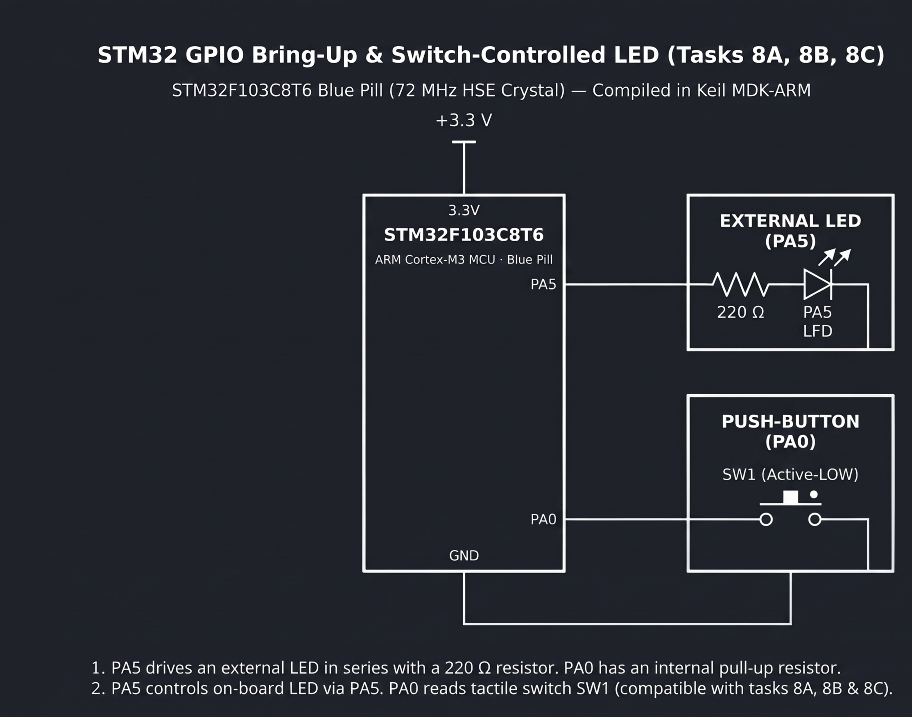

# Continuous Lab Evaluation-8A

**EXP:** Continuous Lab Evaluation-8A  
**DATE:** 21/09/2026  
**NAME OF EXP:** STM32 GPIO Bring-Up & Switch-Controlled LED — Polling-Based Active-Low Push-Button Control  
**HARDWARE SETUP / PLATFORM:** STM32CubeMX + Keil MDK-ARM + STM32F103C8T6 Blue Pill (72 MHz HSE Crystal) + ST-Link Debugger + External LED (`PA5` via `220 Ω` resistor) + Active-Low Push-Button (`SW1` on `PA0`)  
**TASK NO:** 8A  

---

### Circuit Diagram


---

### Core Logic

* **1. GPIO Port A Input & Push-Pull Output Initialization (`MX_GPIO_Init`)**
  Enables the `GPIOA` peripheral clock (`__HAL_RCC_GPIOA_CLK_ENABLE()`), sets `PA5` initially LOW (`GPIO_PIN_RESET`), configures `PA0` as a digital input (`GPIO_MODE_INPUT`) to read tactile switch `SW1`, and configures `PA5` as a push-pull output (`GPIO_MODE_OUTPUT_PP`) to drive the external LED through a `220 Ω` resistor.
  ```c
  __HAL_RCC_GPIOA_CLK_ENABLE();
  HAL_GPIO_WritePin(GPIOA, GPIO_PIN_5, GPIO_PIN_RESET);

  GPIO_InitStruct.Pin = GPIO_PIN_0;
  GPIO_InitStruct.Mode = GPIO_MODE_INPUT;
  GPIO_InitStruct.Pull = GPIO_NOPULL;
  HAL_GPIO_Init(GPIOA, &GPIO_InitStruct);

  GPIO_InitStruct.Pin = GPIO_PIN_5;
  GPIO_InitStruct.Mode = GPIO_MODE_OUTPUT_PP;
  GPIO_InitStruct.Pull = GPIO_NOPULL;
  GPIO_InitStruct.Speed = GPIO_SPEED_FREQ_LOW;
  HAL_GPIO_Init(GPIOA, &GPIO_InitStruct);
  ```

* **2. Active-Low Switch Polling & LED Actuation Loop (`main`)**
  Continuously samples `PA0` via `HAL_GPIO_ReadPin(GPIOA, GPIO_PIN_0)` inside the `while(1)` super-loop; when `SW1` is pressed (`GPIO_PIN_RESET`), `PA5` is driven HIGH (`GPIO_PIN_SET`) to turn the LED ON, and when released, `PA5` is driven LOW (`GPIO_PIN_RESET`) with a `10 ms` `HAL_Delay(10)` polling interval.
  ```c
  while (1)
  {
      if (HAL_GPIO_ReadPin(GPIOA, GPIO_PIN_0) == GPIO_PIN_RESET)
      {
          HAL_GPIO_WritePin(GPIOA, GPIO_PIN_5, GPIO_PIN_SET);   // Turn PA5 LED ON
      }
      else
      {
          HAL_GPIO_WritePin(GPIOA, GPIO_PIN_5, GPIO_PIN_RESET); // Turn PA5 LED OFF
      }

      HAL_Delay(10);
  }
  ```

---

### Inference
Initializing `GPIOA` pins `PA0` (input) and `PA5` (push-pull output) via STM32 HAL on the STM32F103C8T6 Blue Pill successfully demonstrated bare-board GPIO bring-up in Keil MDK-ARM. Polling the active-low tactile switch `SW1` on `PA0` with a `10 ms` loop delay reliably switched the `220 Ω`-protected external LED on `PA5` in real time.