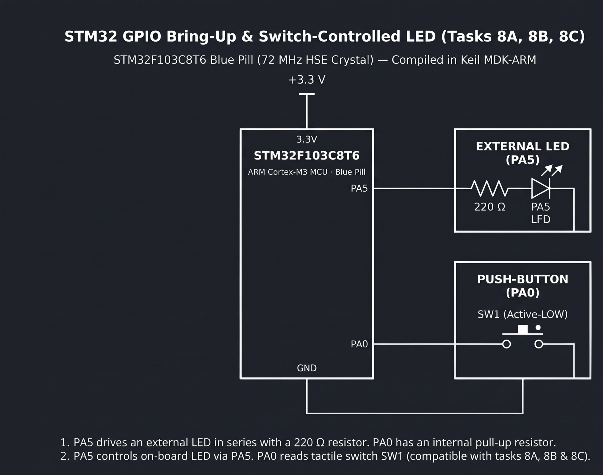

# Continuous Lab Evaluation-8B

**EXP:** Continuous Lab Evaluation-8B  
**DATE:** 21/09/2026  
**NAME OF EXP:** STM32 GPIO Bring-Up & Switch-Controlled LED — Event-Based Toggle Control with Software Debouncing
**HARDWARE SETUP / PLATFORM:** STM32CubeMX + Keil MDK-ARM + STM32F103C8T6 Blue Pill (72 MHz HSE Crystal) + ST-Link Debugger + External LED (`PA5` via `220 Ω` resistor) + Active-Low Push-Button (`SW1` on `PA0`)
**TASK NO:** 8B

---

### Circuit Diagram


---

### Core Logic

* **1. GPIO Port A Input & Push-Pull Output Initialization (`MX_GPIO_Init`)**
  Enables the `GPIOA` peripheral clock (`__HAL_RCC_GPIOA_CLK_ENABLE()`), initializes `PA5` LOW (`GPIO_PIN_RESET`), configures `PA0` as a digital input (`GPIO_MODE_INPUT`) to sample active-low switch `SW1`, and configures `PA5` as a push-pull output (`GPIO_MODE_OUTPUT_PP`) to drive the `220 Ω`-protected external LED.
  ```c
  __HAL_RCC_GPIOA_CLK_ENABLE();
  HAL_GPIO_WritePin(GPIOA, GPIO_PIN_5, GPIO_PIN_RESET);

  GPIO_InitStruct.Pin = GPIO_PIN_0;
  GPIO_InitStruct.Mode = GPIO_MODE_INPUT;
  GPIO_InitStruct.Pull = GPIO_NOPULL;
  HAL_GPIO_Init(GPIOA, &GPIO_InitStruct);

  GPIO_InitStruct.Pin = GPIO_PIN_5;
  GPIO_InitStruct.Mode = GPIO_MODE_OUTPUT_PP;
  GPIO_InitStruct.Pull = GPIO_NOPULL;
  GPIO_InitStruct.Speed = GPIO_SPEED_FREQ_LOW;
  HAL_GPIO_Init(GPIOA, &GPIO_InitStruct);
  ```

* **2. Dual-Edge Software Debounce & Single-Toggle State Lock (`main`)**
  Detects an initial falling edge on `PA0` (`GPIO_PIN_RESET`), waits `20 ms` (`HAL_Delay(20)`) to filter mechanical contact chatter, re-verifies the active-low state before calling `HAL_GPIO_TogglePin(GPIOA, GPIO_PIN_5)`, and then holds in a release-lock loop (`while (HAL_GPIO_ReadPin(GPIOA, GPIO_PIN_0) == GPIO_PIN_RESET)`) followed by a second `20 ms` debounce delay so each physical press triggers strictly one LED state transition.
  ```c
  while (1)
  {
      if (HAL_GPIO_ReadPin(GPIOA, GPIO_PIN_0) == GPIO_PIN_RESET)
      {
          HAL_Delay(20); // Press debounce delay

          if (HAL_GPIO_ReadPin(GPIOA, GPIO_PIN_0) == GPIO_PIN_RESET)
          {
              HAL_GPIO_TogglePin(GPIOA, GPIO_PIN_5); // Toggle LED on PA5

              // Wait until button is fully released
              while (HAL_GPIO_ReadPin(GPIOA, GPIO_PIN_0) == GPIO_PIN_RESET);

              HAL_Delay(20); // Release debounce delay
          }
      }
  }
  ```

---

### Inference
Adding a `20 ms` press-and-release software debounce filter along with a release-lock loop around `HAL_GPIO_TogglePin(GPIOA, GPIO_PIN_5)` successfully eliminated erratic multi-triggering caused by mechanical switch bounce on `SW1` (`PA0`). Each physical button press produced a single, deterministic toggle of the external LED on `PA5` on the STM32F103C8T6 Blue Pill.