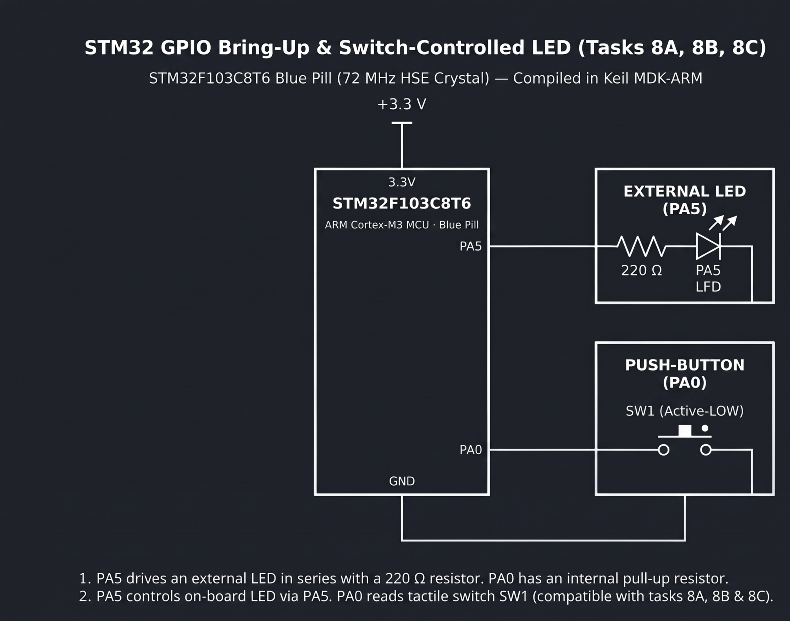

# Continuous Lab Evaluation-8C

**EXP:** Continuous Lab Evaluation-8C  
**DATE:** 21/09/2026  
**NAME OF EXP:** STM32 GPIO Bring-Up & Switch-Controlled LED — Short Press vs. Long Press State Controller  
**HARDWARE SETUP / PLATFORM:** STM32CubeMX + Keil MDK-ARM + STM32F103C8T6 Blue Pill (72 MHz HSE Crystal) + ST-Link Debugger + External LED (`PA5` via `220 Ω` resistor) + Active-Low Push-Button (`SW1` on `PA0`)  
**TASK NO:** 8C  

---

### Circuit Diagram


---

### Core Logic

* **1. GPIO Port A Initialization & Operating State Variables (`MX_GPIO_Init`, `main`)**
  Enables `GPIOA`, configures `PA0` as a digital input (`GPIO_MODE_INPUT`) for active-low switch `SW1` and `PA5` as a push-pull output (`GPIO_MODE_OUTPUT_PP`) initialized LOW (`GPIO_PIN_RESET`) for the `220 Ω`-protected LED, and defines state flags `is_blinking` (`0` = Normal Toggle Mode, `1` = Continuous Blinking Mode) and `last_blink_time` for non-blocking SysTick timing.
  ```c
  uint8_t is_blinking = 0;       // 0 = Normal Toggle Mode, 1 = Continuous Blinking Mode
  uint32_t last_blink_time = 0;  // Non-blocking timer for LED blinking
  ```

* **2. SysTick Press-Duration Measurement & Short/Long Press Classification (`HAL_GetTick`)**
  After a `20 ms` press debounce check on `PA0`, captures `press_start = HAL_GetTick()` and monitors the hold duration (`press_duration = HAL_GetTick() - press_start`) until release. A **Long Press** (`press_duration >= 1000 ms`) activates continuous blinking (`is_blinking = 1`), whereas a **Short Press** (`< 1000 ms`) either stops active blinking and turns `PA5` OFF or toggles `PA5` in normal mode.
  ```c
  uint32_t press_start = HAL_GetTick();

  while (HAL_GPIO_ReadPin(GPIOA, GPIO_PIN_0) == GPIO_PIN_RESET)
  {
      if (is_blinking && (HAL_GetTick() - last_blink_time >= 200))
      {
          HAL_GPIO_TogglePin(GPIOA, GPIO_PIN_5);
          last_blink_time = HAL_GetTick();
      }
  }

  uint32_t press_duration = HAL_GetTick() - press_start;
  HAL_Delay(20);

  if (press_duration >= 1000)
  {
      is_blinking = 1; // LONG PRESS -> Enter Blinking Mode
  }
  else
  {
      if (is_blinking)
      {
          is_blinking = 0;
          HAL_GPIO_WritePin(GPIOA, GPIO_PIN_5, GPIO_PIN_RESET); // Stop blinking
      }
      else
      {
          HAL_GPIO_TogglePin(GPIOA, GPIO_PIN_5); // Toggle LED
      }
  }
  ```

* **3. Non-Blocking `200 ms` Continuous Blinking Loop (`main`)**
  While `is_blinking` is active, compares `HAL_GetTick() - last_blink_time >= 200` on every iteration of the `while(1)` super-loop to toggle `PA5` every `200 ms` without blocking button detection.
  ```c
  if (is_blinking && (HAL_GetTick() - last_blink_time >= 200))
  {
      HAL_GPIO_TogglePin(GPIOA, GPIO_PIN_5); // Toggle LED every 200 ms
      last_blink_time = HAL_GetTick();
  }
  ```

---

### Inference
Using the STM32 HAL `1 ms` SysTick counter (`HAL_GetTick()`) to measure tactile switch hold duration on `PA0` accurately distinguished short presses (`< 1 s`) from long presses (`≥ 1 s`) on the STM32F103C8T6 Blue Pill. Combining `20 ms` press-and-release debouncing with non-blocking `200 ms` timestamp comparisons allowed the external LED on `PA5` to transition cleanly between single-press toggling, continuous blinking, and immediate blink cancellation.