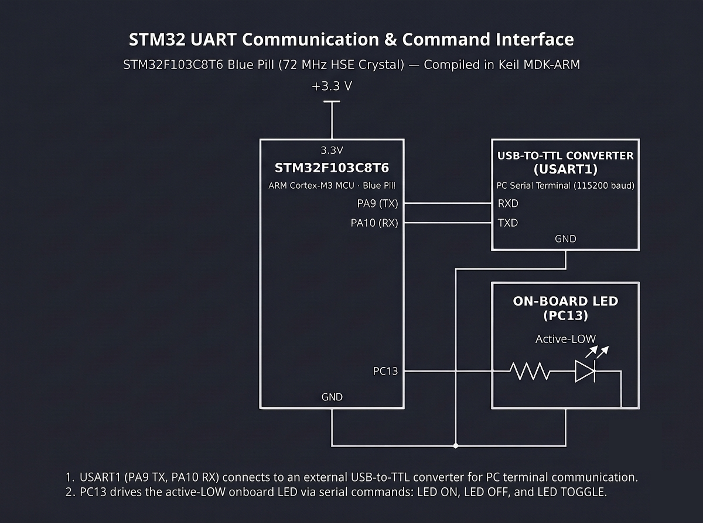

# Continuous Lab Evaluation-9A

**EXP:** Continuous Lab Evaluation-9A  
**DATE:** 28/09/2026  
**NAME OF EXP:** STM32 UART Communication & Command Interface — Basic UART Character Transmission and Echo  
**HARDWARE SETUP / PLATFORM:** STM32CubeMX + Keil MDK-ARM + STM32F103C8T6 Blue Pill (72 MHz HSE Crystal) + USB-to-TTL Converter (`USART1`: `PA9 TX` to `RXD`, `PA10 RX` to `TXD`, shared `GND`) + PC Serial Terminal (`115200-8-N-1`)  
**TASK NO:** 9A  

---

### Circuit Diagram


---

### Core Logic

* **1. `USART1` Peripheral Configuration (`MX_USART1_UART_Init`)**
  Initializes `USART1` (`PA9` TX, `PA10` RX) via `HAL_UART_Init(&huart1)` at `115200 bps` with an `8-bit` word length, `1` stop bit, no parity (`115200-8-N-1`), full-duplex TX/RX mode (`UART_MODE_TX_RX`), no hardware flow control, and `16×` oversampling.
  ```c
  huart1.Instance = USART1;
  huart1.Init.BaudRate = 115200;
  huart1.Init.WordLength = UART_WORDLENGTH_8B;
  huart1.Init.StopBits = UART_STOPBITS_1;
  huart1.Init.Parity = UART_PARITY_NONE;
  huart1.Init.Mode = UART_MODE_TX_RX;
  huart1.Init.HwFlowCtl = UART_HWCONTROL_NONE;
  huart1.Init.OverSampling = UART_OVERSAMPLING_16;
  if (HAL_UART_Init(&huart1) != HAL_OK)
  {
    Error_Handler();
  }
  ```

* **2. Polling Character Reception & Terminal Echo (`HAL_UART_Receive`, `HAL_UART_Transmit`)**
  Polls `USART1` inside the `while(1)` super-loop with a short `10 ms` timeout (`HAL_UART_Receive(&huart1, &rx_data, 1, 10)`); whenever a byte arrives from the PC serial terminal, it immediately echoes the received character back via `HAL_UART_Transmit(&huart1, &rx_data, 1, 100)`.
  ```c
  if (HAL_UART_Receive(&huart1, &rx_data, 1, 10) == HAL_OK)
  {
      // Echo the received char to terminal
      HAL_UART_Transmit(&huart1, &rx_data, 1, 100);
  }
  ```

* **3. Periodic Heartbeat Character Transmission (`HAL_GetTick`)**
  Uses a non-blocking `HAL_GetTick()` timestamp comparison (`HAL_GetTick() - last_tx_time >= 3000`) to transmit `periodic_char` (`'X'`) to the PC terminal every `3 seconds` without interrupting incoming character echo polling.
  ```c
  if (HAL_GetTick() - last_tx_time >= 3000)
  {
      HAL_UART_Transmit(&huart1, &periodic_char, 1, 100);
      last_tx_time = HAL_GetTick();
  }
  ```

---

### Inference
Configuring `USART1` (`PA9` TX / `PA10` RX) on the STM32F103C8T6 Blue Pill at `115200-8-N-1` via `HAL_UART_Init()` established a reliable serial link with the PC terminal over the USB-to-TTL interface. Combining short-timeout `HAL_UART_Receive()` polling with `HAL_GetTick()` interval scheduling enabled simultaneous real-time character echoing and periodic `'X'` transmission every `3 seconds` without blocking serial reception.