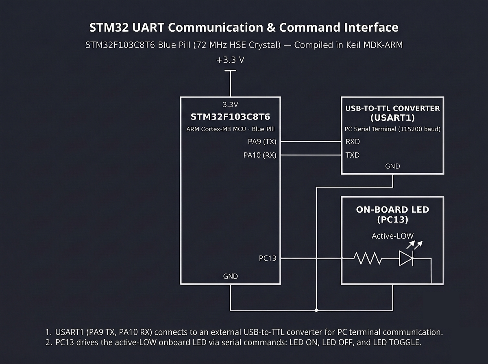

# Continuous Lab Evaluation-9B

**EXP:** Continuous Lab Evaluation-9B  
**DATE:** 28/09/2026  
**NAME OF EXP:** STM32 UART Communication & Command Interface — String-Based Application Logic & Onboard LED Control  
**HARDWARE SETUP / PLATFORM:** STM32CubeMX + Keil MDK-ARM + STM32F103C8T6 Blue Pill (72 MHz HSE Crystal) + USB-to-TTL Converter (`USART1`: `PA9 TX` to `RXD`, `PA10 RX` to `TXD`, shared `GND`) + On-board Active-Low LED (`PC13`) + PC Serial Terminal (`115200-8-N-1`)  
**TASK NO:** 9B  

---

### Circuit Diagram


---

### Core Logic

* **1. `USART1` & Active-Low `PC13` LED Initialization (`MX_USART1_UART_Init`, `MX_GPIO_Init`)**
  Configures `USART1` (`PA9` TX, `PA10` RX) at `115200-8-N-1` (`UART_MODE_TX_RX`), enables `GPIOC` (`PC13` as push-pull output for the Blue Pill's active-low onboard LED), and defines state variables (`led_mode`, `rx_buffer[32]`, `rx_index`, and `last_blink_time`) for non-blocking command parsing.
  ```c
  uint8_t led_mode = 0; // 0 - OFF, 1 - ON, 2 - BLINK
  char rx_buffer[32];
  uint8_t rx_index = 0;
  uint8_t rx_byte;
  uint32_t last_blink_time = 0;
  ```

* **2. Line-Buffered UART Reception & `strcmp()` Command Parser (`main`)**
  Polls `USART1` (`HAL_UART_Receive(&huart1, &rx_byte, 1, 5)`), echoes every typed character back to the terminal, and accumulates incoming bytes into `rx_buffer` until `\r` or `\n` is received. Upon termination, null-terminates the string and matches `"LED ON"`, `"LED OFF"`, or `"LED TOGGLE"` via `strcmp()`, updating `led_mode`, transmitting confirmation feedback (`"LED turned ON\r\n"`, `"LED turned OFF\r\n"`, `"LED toggled (blinking)\r\n"`, or `"Unknown command\r\n"`), and resetting `rx_buffer`.
  ```c
  if (strcmp(rx_buffer, "LED ON") == 0)
  {
      led_mode = 1;
      char msg[] = "LED turned ON\r\n";
      HAL_UART_Transmit(&huart1, (uint8_t *)msg, strlen(msg), 100);
  }
  else if (strcmp(rx_buffer, "LED OFF") == 0)
  {
      led_mode = 0;
      char msg[] = "LED turned OFF\r\n";
      HAL_UART_Transmit(&huart1, (uint8_t *)msg, strlen(msg), 100);
  }
  else if (strcmp(rx_buffer, "LED TOGGLE") == 0)
  {
      led_mode = 2;
      char msg[] = "LED toggled (blinking)\r\n";
      HAL_UART_Transmit(&huart1, (uint8_t *)msg, strlen(msg), 100);
  }
  ```

* **3. Active-Low `PC13` State Machine & Non-Blocking `250 ms` Blinking (`main`)**
  Executes the active `led_mode` continuously inside the `while(1)` super-loop: driving `PC13` HIGH (`GPIO_PIN_SET`) for OFF (`mode 0`), driving `PC13` LOW (`GPIO_PIN_RESET`) for ON (`mode 1`), or toggling `PC13` every `250 ms` via `HAL_GetTick()` for continuous blinking (`mode 2`) without blocking incoming serial commands.
  ```c
  if (led_mode == 0)
  {
      HAL_GPIO_WritePin(GPIOC, GPIO_PIN_13, GPIO_PIN_SET);   // Active-LOW OFF
  }
  else if (led_mode == 1)
  {
      HAL_GPIO_WritePin(GPIOC, GPIO_PIN_13, GPIO_PIN_RESET); // Active-LOW ON
  }
  else if (led_mode == 2 && (HAL_GetTick() - last_blink_time >= 250))
  {
      HAL_GPIO_TogglePin(GPIOC, GPIO_PIN_13);
      last_blink_time = HAL_GetTick();
  }
  ```

---

### Inference
Combining line-buffered `USART1` reception (`115200-8-N-1`) with `strcmp()` command decoding enabled an interactive ASCII serial console on the STM32F103C8T6 Blue Pill. Controlling the active-low onboard LED (`PC13`) through a non-blocking `HAL_GetTick()` state machine allowed immediate transitions between steady ON, steady OFF, and `250 ms` continuous blinking while returning real-time status acknowledgments to the PC terminal.